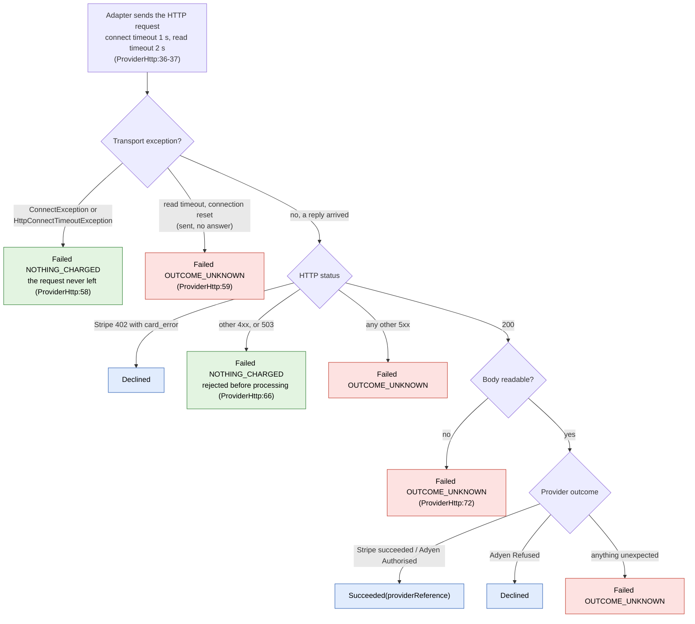
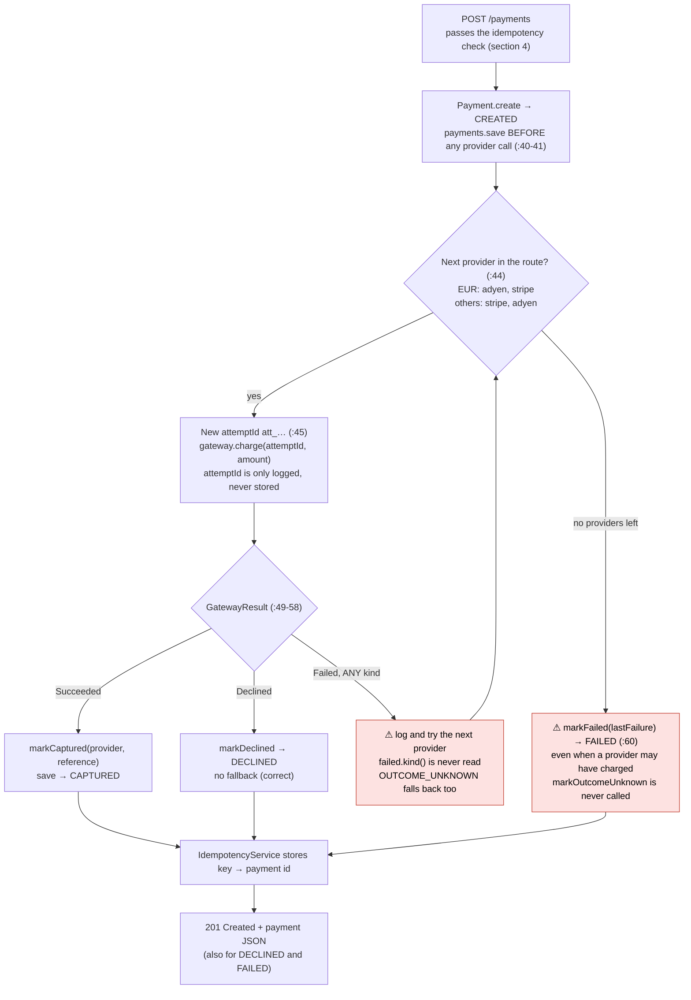
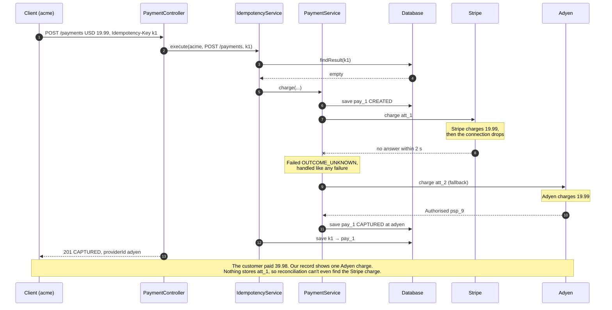
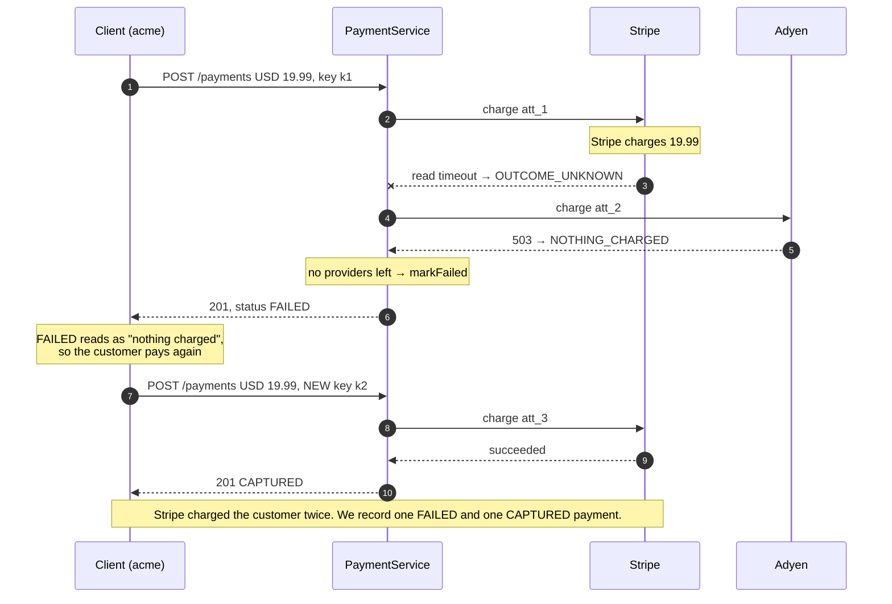
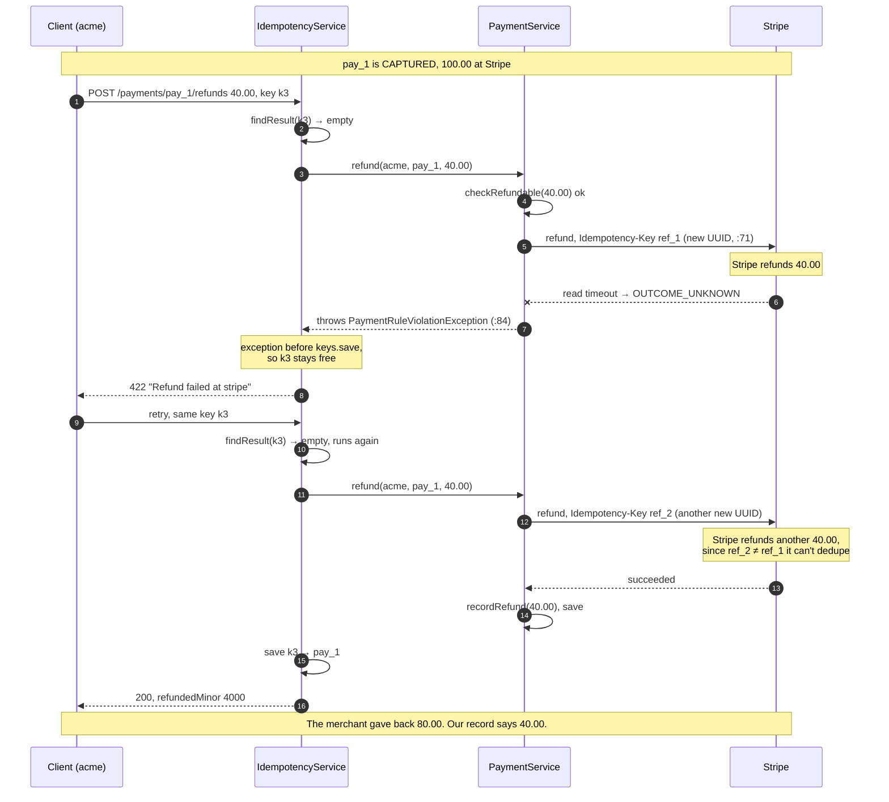
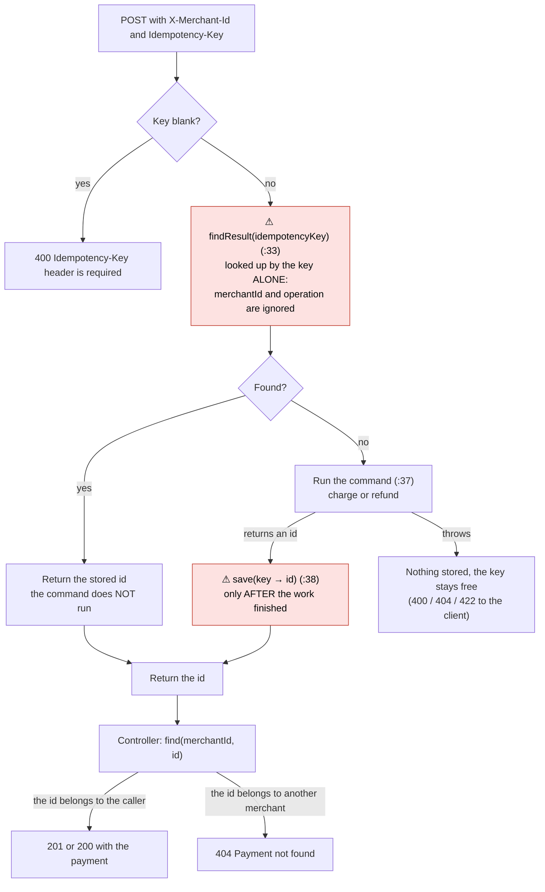
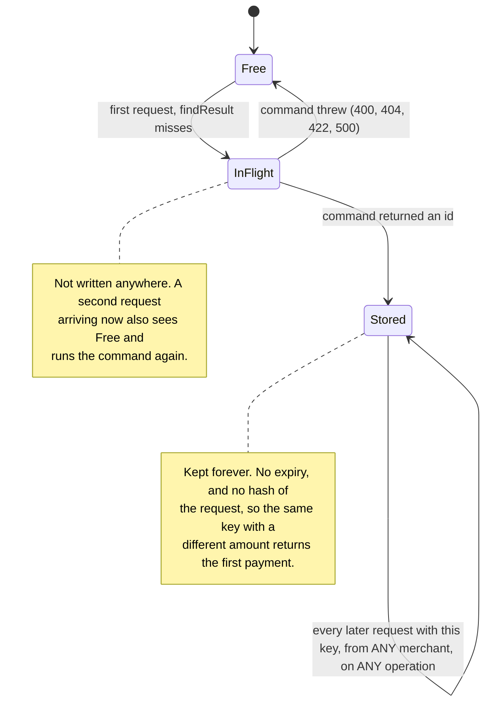
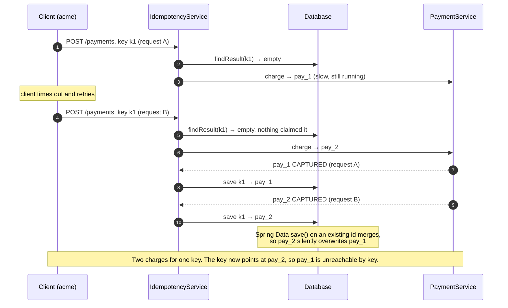
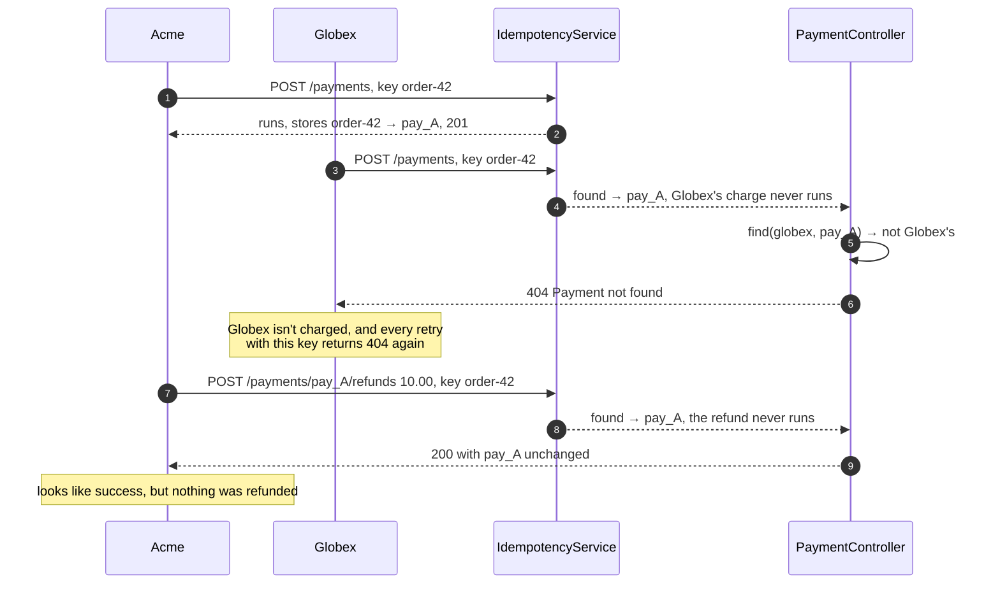

# Level 3 as coded: lost provider responses and idempotency

> **⚠ Spoiler.** This page draws what the Level 3 code *actually does* on these paths, including
> some of the planted issues. Read it only after writing your `NOTES.md`, or if you've decided to
> look.

These diagrams follow the code as it is today, not as it should be. `⚠` marks a step where the
code breaks one of the repo's domain invariants (see the root `CLAUDE.md`). Line numbers refer to
`src/main/java/com/designpatterns/level03/`.

Two ideas this page is about:

- **Outcome unknown.** When a request reached the provider but no usable answer came back (read
  timeout, connection cut, a 500, an unreadable body), the provider *may have charged*. The only
  safe moves are to record "unknown" and find out later (reconciliation, by our attempt id).
  Charging somewhere else can take the money twice.
- **Idempotency key.** The client sends an `Idempotency-Key` so it can retry safely: the same
  request with the same key must run at most once and return the same result. That only works if
  the key is scoped (who sent it, to which operation) and claimed *before* the work starts.

---

## 1. How a provider reply becomes a `GatewayResult`

`integration/support/ProviderHttp.java` plus the two mappers. Adapters never throw: every outcome
becomes one of three results. This part is correct; the trouble starts in who reads it.

Green means it's safe to try another provider; red means the money may already have moved.

---

## 2. Charging: the fallback loop

`service/payment/PaymentService.charge` (lines 39-62).

### 2a. Lost response at the first provider, second one succeeds: charged twice

### 2b. Lost response, then a safe failure: the record says FAILED, but the money moved

The same happens when *every* provider answers with an unknown outcome: the payment ends `FAILED`,
and any or all of them may have charged.

---

## 3. Refunding: a lost response makes the client retry

`service/payment/PaymentService.refund` (lines 65-85) and `PaymentController.refund` (lines 65-79).

An unknown refund outcome is reported as a business-rule violation (HTTP 422), and the attempt
isn't recorded anywhere, so nothing can follow it up.

---

## 4. Idempotency: what `execute` does

`service/idempotency/IdempotencyService.execute` (lines 29-40) and the controller around it.

### 4a. The life of an idempotency key

### 4b. The client retries while the first request is still running

A provider read timeout alone takes 2 s per provider, so a client with a short timeout retries
while the first request is still in the fallback loop.

### 4c. The same key from another merchant, or on another operation

---

## 5. Summary: what each party sees

| Scenario | The client gets | We store | What really moved | Invariant broken |
|---|---|---|---|---|
| Lost response at provider 1, provider 2 succeeds (2a) | 201 `CAPTURED` | `CAPTURED` at provider 2 | charged **twice** | never fall back after an unknown outcome |
| Lost response, provider 2 fails safely (2b) | 201 `FAILED` | `FAILED` | charged once, unrecorded | unknown must stay `OUTCOME_UNKNOWN` until reconciled |
| Lost response at every provider | 201 `FAILED` | `FAILED` | possibly charged at each | same |
| Connection refused / 503 at provider 1, provider 2 succeeds | 201 `CAPTURED` | `CAPTURED` | charged once | none, this fallback is safe |
| Declined | 201 `DECLINED` | `DECLINED` | nothing | none, no fallback (correct) |
| Same key retried after the first request finished | 201, same payment | unchanged | nothing new | none, this is idempotency working |
| Same key retried while the first is still running (4b) | 201 twice | two payments, key → the last | charged **twice** | the key must be claimed before the work |
| Refund with a lost response, retried with the same key (3) | 422, then 200 | refunded 40.00 | refunded **80.00** | the key was never stored, so the retry runs again with a new provider key |
| Another merchant reuses a key (4c) | 404 | nothing | Globex never charged | the key must be scoped to the merchant |
| A charge key reused for a refund (4c) | 200, unchanged | nothing | nothing refunded | the key must be scoped to the operation |

For the intended design, compare Level 2: `service/payment/GatewayResultApplier` (how a result,
including an unknown one, changes a payment) and `presentation/rest/IdempotentRequestExecutor` +
`service/idempotency/IdempotencyService` (keys scoped to merchant + path).
