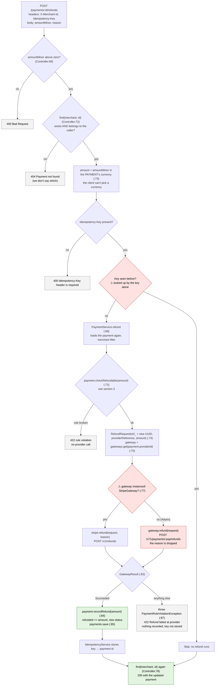
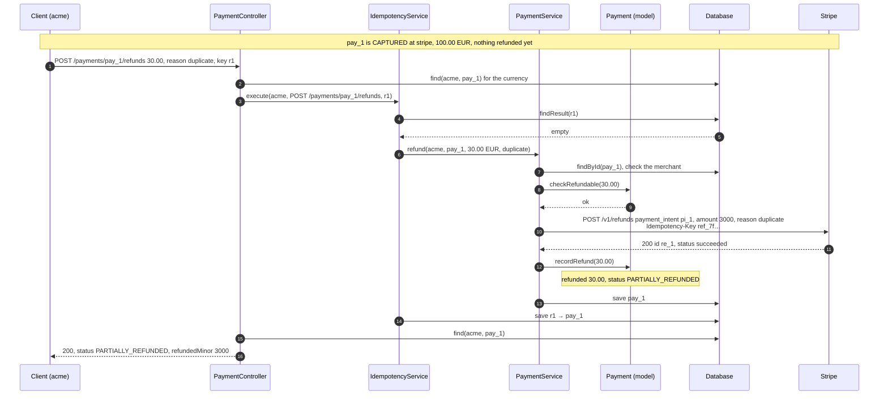
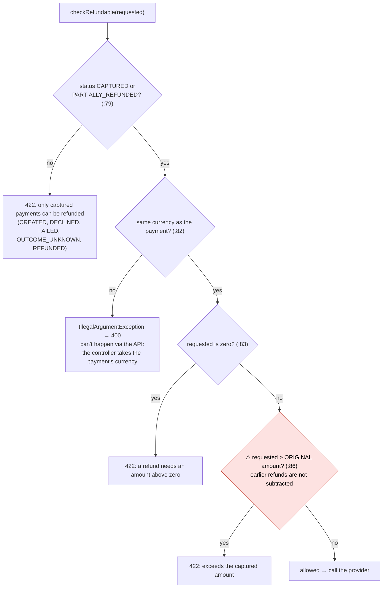
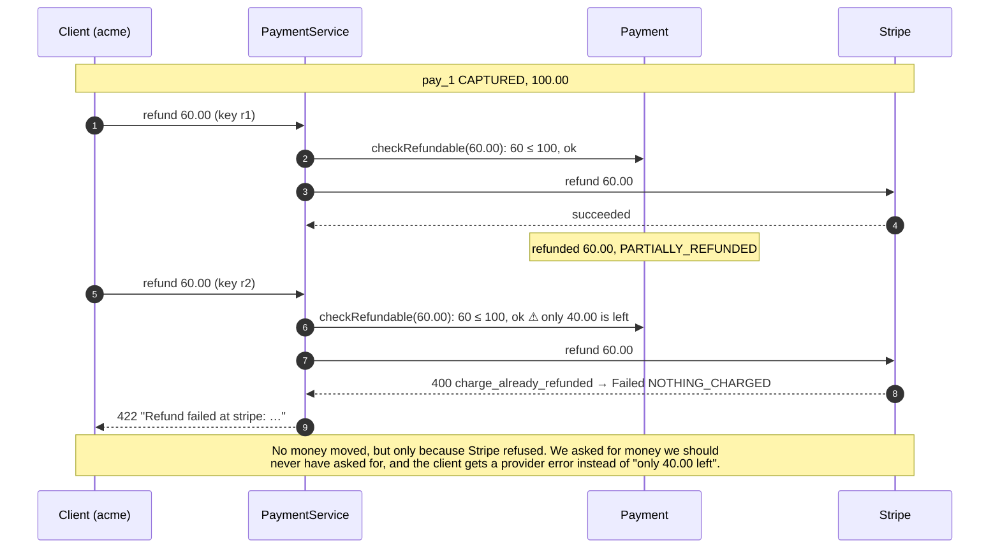
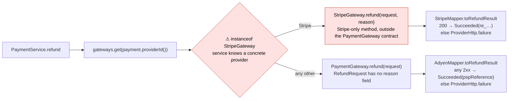
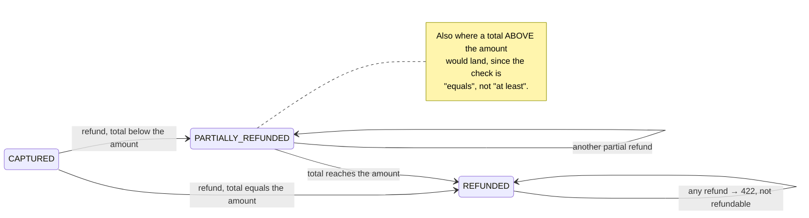

# Level 3 as coded: how a refund works

> **⚠ Spoiler.** This page draws the refund path as the Level 3 code runs it today, including
> some planted issues. Read it after writing your `NOTES.md`, or if you've decided to look.

A refund gives back part or all of a captured payment, **at the provider that charged it**. Three
rules shape the flow:

- **Check before calling.** Business rules (is the payment refundable, is the amount allowed) are
  checked *before* any provider call, so a bad request never moves money.
- **Record only what the provider confirmed.** Our refunded total changes only after a `Succeeded`
  result.
- **One refund per client request.** The `Idempotency-Key` makes a retried request return the first
  result instead of refunding again.

`⚠` marks a step where the code breaks a layering rule or a domain invariant. Line numbers refer
to `src/main/java/com/designpatterns/level03/`.

---

## 1. The whole flow

`PaymentController.refund` (lines 65-79) → `IdempotencyService.execute` → `PaymentService.refund`
(lines 68-88) → `Payment` (lines 78-96) → a provider gateway.

One request reads the payment **three times**: the controller's `find` to learn the currency, the
service's own load, and the final `find` for the response.

---

## 2. The happy path: a partial refund at Stripe

A retry with key `r1` stops at `findResult(r1)` and returns the same payment without calling Stripe
again.

---

## 3. The refund rules (`Payment.checkRefundable`, lines 78-89)

`recordRefund` (lines 92-96) runs the same check again, adds the amount, then sets `REFUNDED` when
the total **equals** the payment amount, otherwise `PARTIALLY_REFUNDED`.

### 3a. Two refunds that add up to more than the payment

Adyen refuses the same way (`422`, code `167 Refund amount exceeded`). If a provider didn't check,
our record would show 120.00 refunded on a 100.00 payment, still marked `PARTIALLY_REFUNDED`,
because the status test is "equals".

---

## 4. Choosing the provider and reading its answer

The refund always goes to `payment.providerId()`, never through routing or fallback: only the
provider that charged can refund.

| | Stripe-like | Adyen-like |
|---|---|---|
| Request | `POST /v1/refunds` | `POST /v71/payments/{psp}/refunds` |
| Our idempotency key to the provider | `Idempotency-Key: ref_…` (new UUID per call) | `Idempotency-Key: ref_…`, also sent as `reference` |
| Body | `payment_intent`, `amount`, `reason` (left out when null) | `amount`, `merchantAccount`, `reference`. **No reason** |
| Success reply | `200 {id: re_…, status: succeeded}` | `201 {pspReference, status: received}` |
| How we read it | `Succeeded`. The `status` field is parsed but never checked | `Succeeded` for any 2xx. `received` means *accepted*, not *done*; Level 3 has no webhook to learn the final outcome |
| Over-refund reply | `400 charge_already_refunded` → `NOTHING_CHARGED` | `422`, code `167` → `NOTHING_CHARGED` |
| Lost response | read timeout or connection cut → `OUTCOME_UNKNOWN` | same |

Every non-success becomes **HTTP 422 "rule violation"**, even a provider outage (503) or an
unknown outcome. See section 3 of `LOST-RESPONSE-AND-IDEMPOTENCY-FLOWS.md` for what a lost refund
response does when the client retries.

---

## 5. Payment status during refunds

`CREATED`, `DECLINED`, `FAILED` and `OUTCOME_UNKNOWN` payments can't be refunded (422).

---

## 6. Summary: every outcome

| Situation | Client gets | Payment after | Money at the provider |
|---|---|---|---|
| `amountMinor` missing or ≤ 0 | 400 | unchanged | nothing |
| Unknown id, or another merchant's payment | 404 | unchanged | nothing |
| No `Idempotency-Key` (checked after the 404) | 400 | unchanged | nothing |
| Payment not `CAPTURED` / `PARTIALLY_REFUNDED` | 422 | unchanged | no call made |
| Amount above the original payment | 422 | unchanged | no call made |
| ⚠ Amount within the original but above what's left (3a) | 422 "Refund failed at …" | unchanged | provider asked, refused |
| Provider down (connection refused) or 503 | 422 "Refund failed at …" | unchanged | nothing |
| Provider succeeds | 200 | refunded += amount, `PARTIALLY_REFUNDED` / `REFUNDED` | refunded |
| Same key retried after a success | 200, same payment | unchanged | nothing new |
| ⚠ Lost response, then a retry with the same key | 422, then 200 | records **one** refund | refunded **twice** |
| ⚠ Adyen payment with a `reason` | 200 | refunded | refunded, reason lost |
| ⚠ Two refunds at the same moment | 200 twice | both read the same state, last save wins, so one refund is missing from our total | both refunded |
| ⚠ A key used before, by anyone, on any operation | 200 | unchanged | **nothing refunded** |
