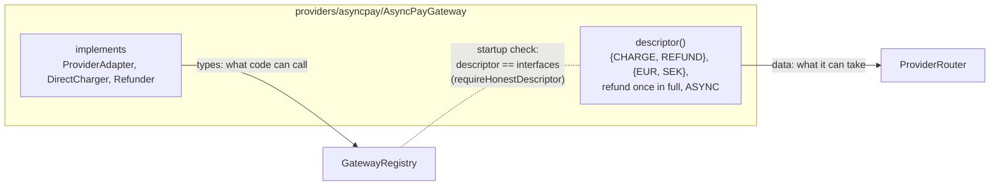
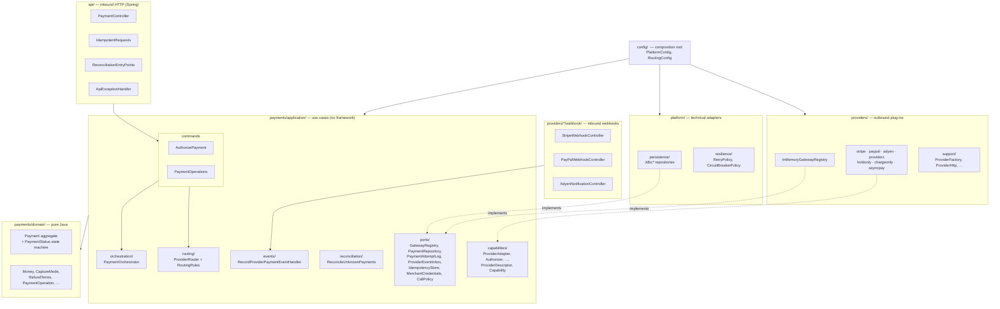
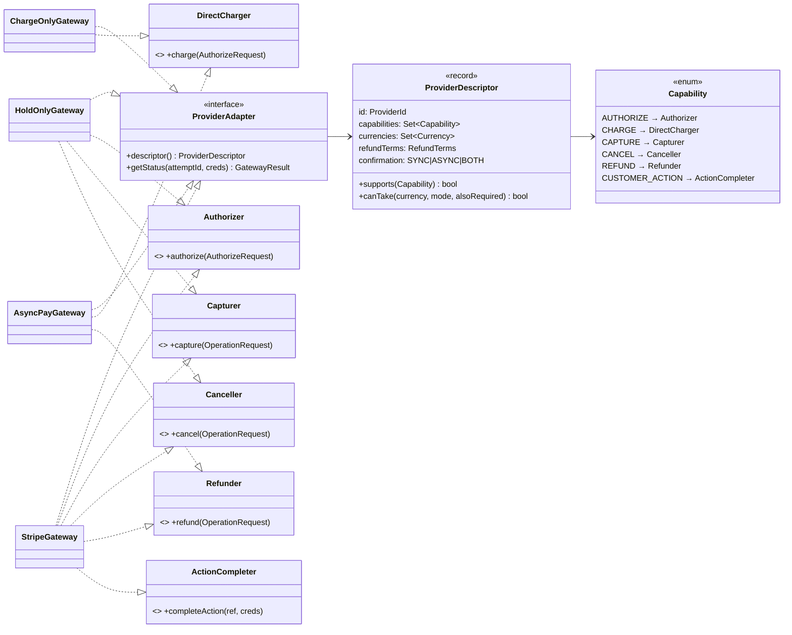
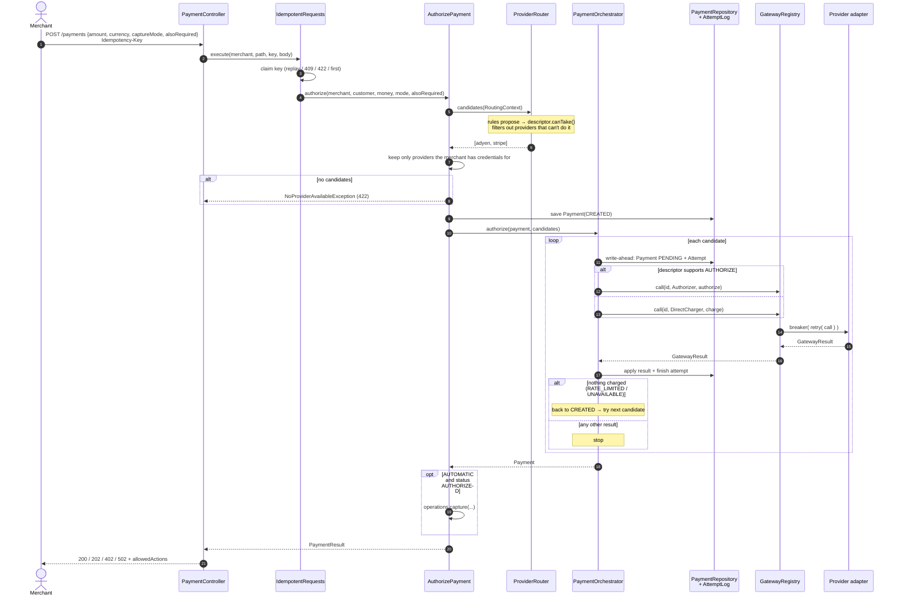
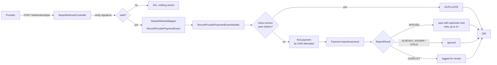
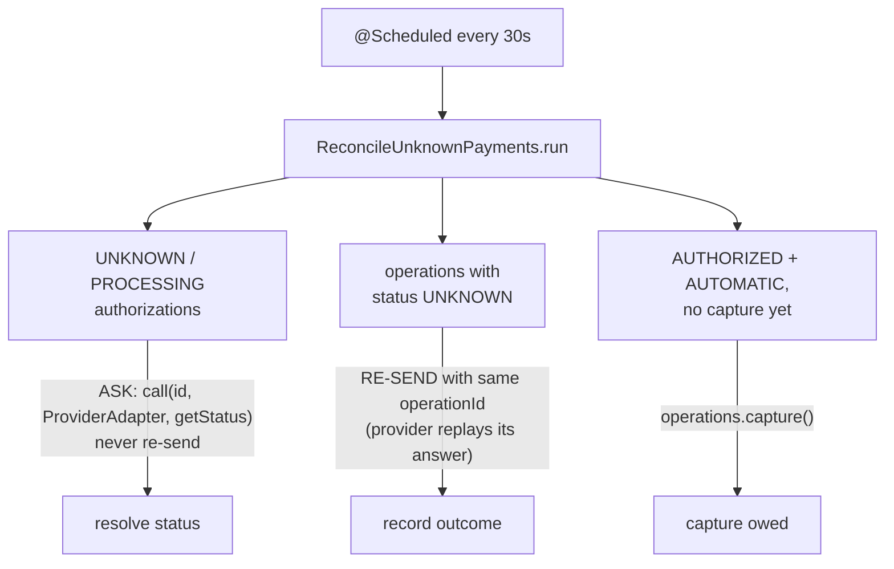
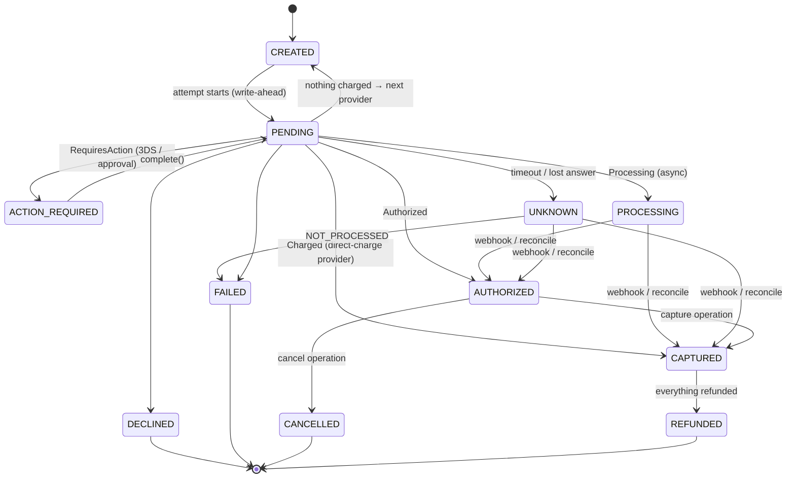
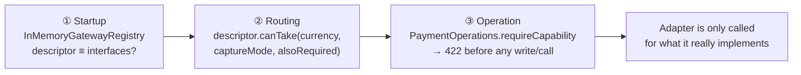
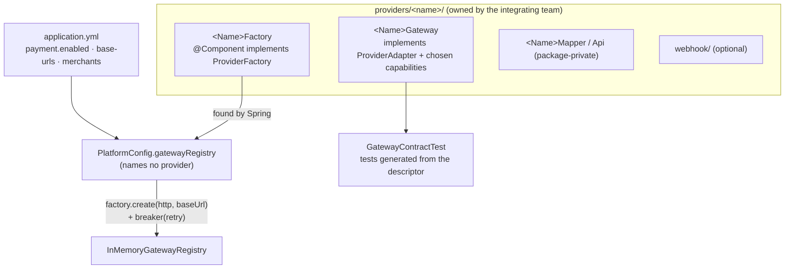

# Level 8 — Architecture

How the payment platform is put together once it has to work with many providers that don't all
do the same things. This page covers the parts, how they depend on each other, and how a request
moves through them. For *why* it is built this way, see [ADR-0005](adr/0005-capability-model.md)
and [Where the abstraction leaked](WHERE-THE-ABSTRACTION-LEAKED.md). For onboarding a new provider,
see [Adding a provider](ADDING-A-PROVIDER.md).

---

## 1. The idea in one picture

A provider no longer implements one large `PaymentProvider` interface. It makes **two claims about
itself**, and the platform checks at startup that the two agree:

| Claim | Form | Who reads it | Purpose |
|-------|------|--------------|---------|
| **What code can call** | Small interfaces it implements: `Authorizer`, `DirectCharger`, `Capturer`, `Canceller`, `Refunder`, `ActionCompleter` | `GatewayRegistry.call(id, Capability.class, …)` | You can't call a method the provider doesn't have |
| **What it can take** | A `ProviderDescriptor` (data): capabilities, currencies, refund terms, confirmation style | `ProviderRouter`, `PaymentOperations` | Rule providers out **before** any call is made |



This is **option D** from the README: segregated interfaces + a capability descriptor.

---

## 2. Layers and packages



**Dependency rules** (enforced by `ArchitectureTest`):

- `payments/domain` is pure Java: no Spring, no JDBC, no provider types.
- `payments/application` depends only on the domain and on its own ports/capability interfaces.
- Each `providers/<name>/` folder exposes only its gateway class publicly; mappers, API clients and
  webhook DTOs stay package-private.
- `config/` is the **only** place that knows every module. It names no provider: providers
  register themselves through a `ProviderFactory` `@Component`.

---

## 3. Components

### Inbound

| Component | Responsibility |
|-----------|----------------|
| `PaymentController` | Public REST API: `POST /payments`, `/complete`, `/capture`, `/cancel`, `/refund`, `GET /payments/{id}`, `/history`. Maps payment/operation status to an HTTP status. |
| `IdempotentRequests` | Requires `Idempotency-Key` on every command that moves money. The key is scoped to merchant + path. Replays the stored response, answers 409 while the first request is still running, and 422 if the key is reused with a different body. |
| `CorrelationIdFilter` | Puts a correlation id into the MDC for log tracing. |
| `ApiExceptionHandler` | Turns domain/application exceptions into `ProblemDetail` responses (e.g. `OperationNotSupportedException` → 422). |
| `*WebhookController` | One per provider that pushes events: **verify signature → map to `RecordProviderPaymentEvent` → handler → 200**. |

### Application (use cases)

| Component | Responsibility |
|-----------|----------------|
| `AuthorizePayment` | Starts a payment: checks the merchant, asks the router for candidates, keeps only providers the merchant has credentials for, creates the `PaymentTest`, hands it to the orchestrator. With `AUTOMATIC` mode on an auth+capture provider, it captures right away. |
| `ProviderRouter` | **Pure.** Runs the routing rules in order (merchant override → currency → default → fallback order), then **filters each proposal through `ProviderDescriptor.canTake(currency, captureMode, alsoRequired)`**. Returns an ordered list with no duplicates. |
| `RoutingRule` (Strategy) | `MerchantOverrideRule`, `CurrencyRule`, `DefaultRule`. Each proposes at most one provider. |
| `PaymentOrchestrator` | Runs authorize attempts across candidates: **write-ahead → call → record**. Calls `Authorizer` if the provider holds funds, otherwise `DirectCharger`. Moves on to the next candidate **only** when the failure proves nothing was charged. |
| `PaymentOperations` | Capture / cancel / refund on an existing payment. **Checks the capability against the descriptor first** (`requireCapability`), then reserves the operation (commit), calls the provider with the operation id as idempotency key, and records the result. Also works out `allowedActions` for the response. |
| `RecordProviderPaymentEventHandler` | Handles webhooks for all providers: inbox dedup → find the payment by our attempt id → `Payment.report(...)` → save with an optimistic lock. |
| `ReconcileUnknownPayments` | Scheduled job. For `UNKNOWN`/`PROCESSING` authorizations it **asks** the provider (`getStatus`). For operations with an unknown result it **re-sends** them with the same operation id. It also runs captures still owed on `AUTOMATIC` payments. |

### Capabilities (the provider SPI)



Every `Capability` value points to its interface (`Capability.type()`), so
`InMemoryGatewayRegistry.requireHonestDescriptor` can check, for each value, that
`descriptor.supports(c) == c.type().isInstance(adapter)`. If any provider's descriptor disagrees
with its code, the app **won't start**.

### Ports and outbound adapters

| Port (application) | Adapter | Notes |
|--------------------|---------|-------|
| `GatewayRegistry` | `InMemoryGatewayRegistry` | `call(id, Capability.class, fn)` casts the adapter to the capability and runs it through that provider's `CallPolicy`. |
| `CallPolicy` | `CircuitBreakerPolicy( RetryPolicy( call ) )` | Built once per provider in `PlatformConfig`. Works for **any** capability without knowing what it is. |
| `PaymentRepository` | `JdbcPaymentRepository` | Optimistic locking, so a race fails with `ConcurrentUpdateException`. |
| `PaymentAttemptLog` | `JdbcPaymentAttemptLog` | One row per provider attempt, written **before** the call. |
| `ProviderEventInbox` | `JdbcProviderEventInbox` | Deduplicates webhooks by (provider, eventId). |
| `IdempotencyStore` | `JdbcIdempotencyStore` | API-level idempotency keys. |
| `MerchantCredentials` | `ConfiguredMerchants` | merchant → provider → credentials (from `application.yml`). |

---

## 4. Flows

### 4.1 Authorize (`POST /payments`)



### 4.2 Capture / cancel / refund

The capability check happens **before** anything is stored or sent. A refund on `chargeonly`
never reaches the adapter.

```mermaid
sequenceDiagram
    autonumber
    actor M as Merchant
    participant C as PaymentController
    participant PO as PaymentOperations
    participant G as GatewayRegistry
    participant Pay as Payment (aggregate)
    participant DB as PaymentRepository
    participant P as Provider (Refunder)

    M->>C: POST /payments/{id}/refund {amount}
    C->>PO: refund(merchant, id, amount)
    PO->>DB: load payment
    PO->>G: descriptor(providerId).supports(REFUND)?
    alt not supported
        PO-->>C: OperationNotSupportedException → 422
    end
    PO->>Pay: startRefund(opId, amount, refundTerms)
    Note over Pay: enforces RefundTerms<br/>(partial allowed? max refunds?)<br/>and refundable balance
    PO->>DB: save (reserves amount; a concurrent request loses on the optimistic lock)
    PO->>G: call(id, Refunder, refund(opId as idempotency key))
    G->>P: breaker( retry( refund ) )
    P-->>PO: Done / Declined / Failed
    PO->>DB: reload latest → apply → save (retry on race)
    PO-->>C: PaymentResult(operationId)
    C-->>M: 200 SUCCEEDED / 202 UNKNOWN / 502 FAILED
```

### 4.3 Webhooks



Webhook controllers live **inside** each provider's folder, because both directions speak that
provider's language. The core only sees the shared `RecordProviderPaymentEvent` command.

### 4.4 Reconciliation



`getStatus` belongs to `ProviderAdapter` itself, so every provider has it. Reconciliation needs it
no matter what else a provider can do.

---

## 5. Payment state machine



Captured and refunded **amounts** are not statuses. They come from the payment's
`PaymentOperation` list, so the two can't contradict each other.

---

## 6. How a failure decides what happens next

Adapters convert every provider error into a `FailureCategory`. Retry, the circuit breaker and
fallback only look at the category, never at an HTTP code.

| Category | Might have charged? | Retry same provider | Fall back to next | Payment ends in |
|----------|:-:|:-:|:-:|---|
| `INVALID_REQUEST` | no | ✗ | ✗ | `FAILED` |
| `RATE_LIMITED` | no | ✓ | ✓ | next candidate |
| `PROVIDER_UNAVAILABLE` | no | ✓ | ✓ | next candidate |
| `OUTCOME_UNKNOWN` | **yes** | ✗ | ✗ | `UNKNOWN` → reconciliation |
| `NOT_PROCESSED` | no | — | — | only from `getStatus` |

A `Declined` is not a failure. It is never retried and never sent to another provider.

---

## 7. Where "can't do that" is handled

A missing capability is handled at three points, and each one is earlier than an exception from
inside an adapter could be:



`allowedActions` in every response tells the merchant in advance what the payment's provider can
still do (for example `[]` for a captured `chargeonly` payment).

---

## 8. Provider plug-in model



Provider #21 touches its own folder, one `enabled` entry, and its config. Nothing changes in
`payments/`. The shared contract kit (`GatewayContractTest`) runs against every adapter and turns
on test groups based on what the descriptor declares.

### Current providers

| Provider | Authorize | Charge | Capture | Cancel | Refund | Customer step | Currencies | Results |
|----------|:-:|:-:|:-:|:-:|:-:|:-:|---|---|
| stripe | ✅ | | ✅ | ✅ | ✅ | ✅ | EUR USD GBP JPY | sync or async |
| paypal | ✅ | | ✅ | ✅ | ✅ | ✅ | EUR USD GBP | sync |
| adyen | ✅ | | ✅ | ✅ | ✅ | ✅ | EUR USD GBP JPY | sync or async |
| providerx | | ✅ | | | ✅ | | EUR USD | sync |
| holdonly | ✅ | | ✅ | ✅ | | | EUR USD | sync |
| chargeonly | | ✅ | | | | | EUR USD | sync |
| asyncpay | | ✅ | | | once, in full | | EUR SEK | async |

---

## 9. Patterns used

| Pattern / principle | Where |
|---------------------|-------|
| Interface Segregation | `capabilities/*`: one interface per operation |
| Capability descriptor (data-driven routing) | `ProviderDescriptor` + `ProviderRouter` |
| Strategy | `RoutingRule` implementations |
| Ports & Adapters (hexagonal) | `application/ports` ↔ `platform/`, `providers/` |
| Plug-in / self-registration | `ProviderFactory` `@Component` per provider |
| Decorator | `CircuitBreakerPolicy( RetryPolicy( call ) )` around every gateway call |
| Anti-corruption layer | Per-provider `Mapper`s → `GatewayResult` / `FailureCategory` |
| Write-ahead log | `PaymentAttempt` saved before each provider call |
| Idempotency (API, operation, inbox) | `IdempotentRequests`, operation id as provider key, `ProviderEventInbox` |
| Optimistic concurrency | `PaymentRepository` + reload-and-reapply loops |
| Contract test kit (TCK) | `GatewayContractTest` |
| Composition root | `PlatformConfig`, `RoutingConfig` |
