# Proposal: Level 8 as a Layered Architecture

> **Status:** proposal (not implemented)
> **Scope:** `..`, all 113 production classes
> **Question:** What would the Level 8 payment platform look like in a classic **layered**
> (N-tier) architecture instead of the current **hexagonal** (ports & adapters) one? What would we
> gain and what would we lose?

---

## Contents

1. [Summary](#1-summary)
2. [Level 8 today: the hexagonal baseline](#2-level-8-today-the-hexagonal-baseline)
3. [The layered rules this proposal follows](#3-the-layered-rules-this-proposal-follows)
4. [Layers and packages](#4-layers-and-packages)
5. [Class-level design, layer by layer](#5-class-level-design-layer-by-layer)
6. [Flows in the layered design](#6-flows-in-the-layered-design)
7. [How the Level 8 requirements survive the move](#7-how-the-level-8-requirements-survive-the-move)
8. [Enforcing the layers (ArchUnit)](#8-enforcing-the-layers-archunit)
9. [Testing strategy](#9-testing-strategy)
10. [Trade-offs: layered vs hexagonal](#10-trade-offs-layered-vs-hexagonal)
11. [Recommendation](#11-recommendation)
12. [Migration plan (if we go ahead)](#12-migration-plan-if-we-go-ahead)
13. [Appendix A: every class, old location → new location](#appendix-a-every-class-old-location--new-location)
14. [Appendix B: glossary](#appendix-b-glossary)

---

## 1. Summary

The layered version stacks the code into five horizontal layers. Each layer may only call the layers
**below** it:

```
presentation  →  service  →  persistence / integration  →  model
```

The biggest change from today is **which way the dependencies point**:

| | Hexagonal (today) | Layered (proposed) |
|---|---|---|
| Who owns `PaymentRepository`? | The core (`payments/application/ports`) | The persistence layer |
| Who owns `Refunder`, `GatewayResult`? | The core (`payments/application/capabilities`, `ports`) | The integration layer |
| Business code depends on… | only its own interfaces | the persistence and integration layers below it |
| JDBC / provider code depends on… | the core (it implements the core's interfaces) | only the model layer |

Everything that makes Level 8 work can be kept: segregated capability interfaces, the
`ProviderDescriptor`, filtering in the router before choosing, the 422 before any call, the
startup honesty check and the contract test kit (TCK). They move to different packages, and the
**integration layer**, not the business core, becomes the owner of the provider contract.

**Recommendation in one line:** the layered design is workable and easier for newcomers to read,
but for this level the hexagonal design is the better fit. Level 8 is about letting many provider
plug-ins grow without touching the core, and that needs the core to own the contract. See
[§11](#11-recommendation).

---

## 2. Level 8 today: the hexagonal baseline

### 2.1 Modules and dependency direction

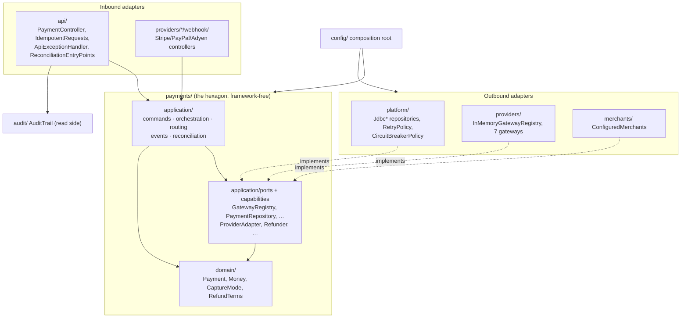

**All arrows point inward.** The core never imports Spring, JDBC, Jackson or any provider class.
`ArchitectureTest` enforces this with 10 rules.

### 2.2 What Level 8 specifically added

| Mechanism | Where | Why it matters for the comparison |
|-----------|-------|-----------------------------------|
| Capability interfaces (`Authorizer`, `DirectCharger`, `Capturer`, `Canceller`, `Refunder`, `ActionCompleter`) | `payments/application/capabilities` | The **core** defines what a provider can be asked to do |
| `ProviderDescriptor` + `Capability` enum | same | Data the router filters on before choosing |
| `GatewayRegistry.call(id, Capability.class, fn)` | port in core, impl in `providers/` | One place where resilience wraps every call |
| `requireHonestDescriptor` | `InMemoryGatewayRegistry` | App won't start if the descriptor and the interfaces disagree |
| `ProviderFactory` self-registration | `providers/support` | `config/` names no provider |
| `GatewayContractTest` (TCK) | tests | Tests are generated from each descriptor |
| Webhook controllers inside `providers/<name>/webhook/` | providers | Everything "Stripe" lives in one folder |

### 2.3 Size today

| Package | Classes |
|---------|--------:|
| `api` | 7 |
| `audit` | 2 |
| `config` | 3 |
| `merchants` | 1 |
| `payments/domain` | 18 |
| `payments/application` | 40 |
| `platform` | 6 |
| `providers` | 36 |
| **Total** | **113** |

---

## 3. The layered rules this proposal follows

"Layered" can mean several things. This proposal uses a precise version so the comparison is fair.

1. **Five layers**, top to bottom: `presentation`, `service`, `persistence` and `integration`
   (side by side), and `model`.
2. **Dependencies only point down.** A layer may use any layer below it, never one above it.
3. **Closed service layer.** `presentation` may not skip `service` to reach `persistence` or
   `integration`. (Persistence and integration are *closed* to presentation.)
4. **`persistence` and `integration` don't know each other.** Both are leaves above `model`.
5. **`model` is shared.** Every layer may use `PaymentTest`, `MoneyTest`, ids and enums. This is the usual
   "relaxed" choice: persistence must build `PaymentTest` objects, so a strictly closed model is not
   practical.
6. **Interfaces belong to the layer that implements them.** `PaymentRepository` lives in
   `persistence`, next to `JdbcPaymentRepository`. This is the key difference from hexagonal.
   If the service layer owned the interface and persistence implemented it, the arrow would point
   up, and we would be back to ports & adapters.
7. **`config` is cross-cutting.** It is the composition root, like today, and the only package that
   may see everything.

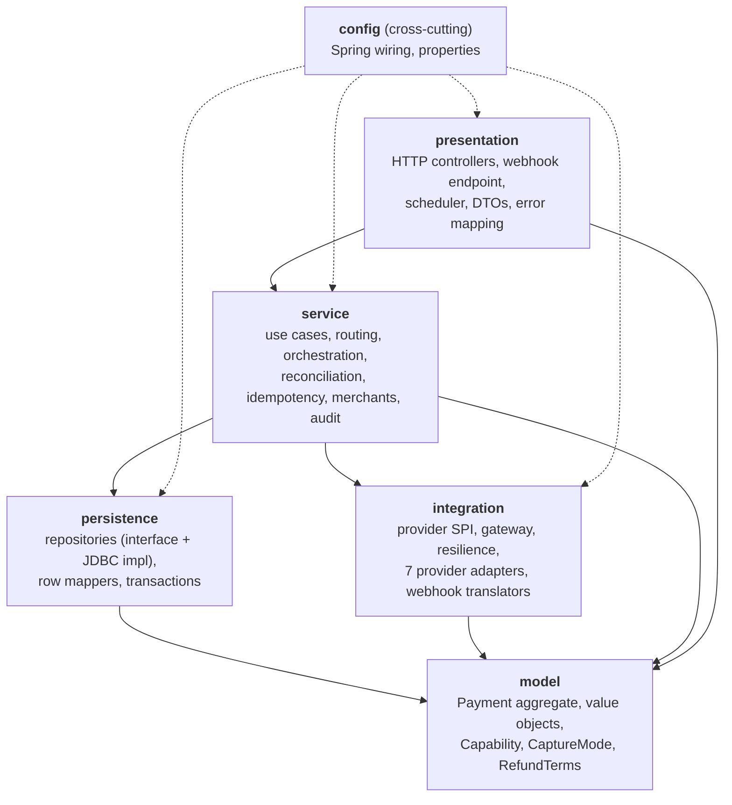

---

## 4. Layers and packages

### 4.1 Package tree

Root package stays `com.designpatterns.level08`. Only the layout below the root changes.

```
com.designpatterns.level08
├── com.designpatterns.level09.PaymentPlatformApplication
│
├── presentation/                         ── LAYER 1: entry points (Spring MVC, scheduling)
│   ├── rest/
│   │   ├── PaymentController
│   │   ├── AdminReconciliationController
│   │   ├── IdempotentRequestExecutor     (was api/IdempotentRequests)
│   │   ├── ApiExceptionHandler
│   │   └── CorrelationIdFilter
│   ├── rest/dto/
│   │   ├── AuthorizeRequestDto           (was PaymentRequests.Authorize)
│   │   ├── AmountDto                     (was PaymentRequests.Amount)
│   │   └── PaymentResponseDto            (was PaymentResponse)
│   ├── webhook/
│   │   └── ProviderWebhookController     (ONE endpoint: POST /webhooks/{provider})
│   └── scheduling/
│       └── ReconciliationScheduler       (was ReconciliationEntryPoints.Job)
│
├── service/                              ── LAYER 2: business logic (no Spring MVC, no JDBC)
│   ├── payment/
│   │   ├── PaymentService                (was AuthorizePayment)
│   │   ├── PaymentOperationService       (was PaymentOperations)
│   │   ├── AuthorizationOrchestrator     (was PaymentOrchestrator)
│   │   ├── PaymentResult
│   │   └── GatewayResultApplier          (NEW: the GatewayResult → Payment switches, shared)
│   ├── routing/
│   │   ├── ProviderRoutingService        (was ProviderRouter)
│   │   ├── RoutingContext
│   │   ├── RoutingRule
│   │   └── rules/ MerchantOverrideRule, CurrencyRule, DefaultRule
│   ├── event/
│   │   ├── ProviderEventService          (was RecordProviderPaymentEventHandler)
│   │   └── EventOutcome
│   ├── reconciliation/
│   │   └── ReconciliationService         (was ReconcileUnknownPayments)
│   ├── idempotency/
│   │   └── IdempotencyService            (NEW thin service over IdempotencyKeyRepository)
│   ├── merchant/
│   │   └── MerchantService               (was ConfiguredMerchants + MerchantCredentials port)
│   ├── audit/
│   │   ├── AuditService                  (was AuditTrail, minus the SQL)
│   │   └── AuditEntry
│   └── exception/
│       ├── NoProviderAvailableException
│       ├── OperationNotSupportedException
│       ├── UnknownMerchantException
│       └── UnknownPaymentException
│
├── persistence/                          ── LAYER 3a: data access
│   ├── PaymentRepository                 (interface)    + jdbc/JdbcPaymentRepository
│   ├── PaymentAttemptRepository          (interface)    + jdbc/JdbcPaymentAttemptRepository
│   ├── ProviderEventInboxRepository      (interface)    + jdbc/JdbcProviderEventInboxRepository
│   ├── IdempotencyKeyRepository          (interface)    + jdbc/JdbcIdempotencyKeyRepository
│   ├── AuditEventRepository              (interface)    + jdbc/JdbcAuditEventRepository
│   ├── MerchantConfigRepository          (interface)    + config/PropertiesMerchantConfigRepository
│   ├── IdempotencyClaim                  (sealed, was IdempotencyStore.Claim)
│   └── ConcurrentUpdateException
│
├── integration/                          ── LAYER 3b: outside world (payment providers)
│   ├── gateway/                          (the provider SPI + the single way to call it)
│   │   ├── ProviderGateway               (interface, was GatewayRegistry port)
│   │   ├── DefaultProviderGateway        (was InMemoryGatewayRegistry)
│   │   ├── ProviderAdapter
│   │   ├── capability/ Authorizer, DirectCharger, Capturer, Canceller, Refunder, ActionCompleter
│   │   ├── CapabilityBinding             (NEW: Capability → interface class)
│   │   ├── ProviderDescriptor
│   │   ├── GatewayResult, FailureCategory
│   │   ├── AuthorizeRequest, OperationRequest, ProviderCredentials
│   │   └── ProviderFactory
│   ├── webhook/
│   │   ├── ProviderEventTranslator       (NEW interface: verify + map raw webhook)
│   │   ├── ProviderEvent                 (was RecordProviderPaymentEvent)
│   │   └── WebhookTranslators            (NEW: lookup by provider id)
│   ├── resilience/
│   │   ├── CallPolicy, RetryPolicy, CircuitBreakerPolicy
│   ├── support/  ProviderHttp, Signatures, SyntheticClient
│   └── provider/
│       ├── stripe/     StripeGateway, StripeFactory, StripeApi*, StripeMapper*,
│       │               StripeEventTranslator, StripeWebhookMapper*, StripeWebhookVerifier*
│       ├── paypal/     PayPalGateway, …, PayPalEventTranslator, …
│       ├── adyen/      AdyenGateway, …, AdyenEventTranslator, …
│       ├── providerx/  ProviderXGateway, …
│       ├── holdonly/   HoldOnlyGateway, HoldOnlyFactory
│       ├── chargeonly/ ChargeOnlyGateway, ChargeOnlyFactory
│       └── asyncpay/   AsyncPayGateway, AsyncPayFactory
│                                         (* = package-private, as today)
│
├── model/                                ── LAYER 4: shared domain model (pure Java)
│   ├── Payment, PaymentStatus, PaymentEvent, PaymentOperation, PaymentAttempt, AttemptOutcome
│   ├── Money, PaymentId, MerchantId, ProviderId
│   ├── CaptureMode, RefundTerms, Capability      (Capability MOVED DOWN from application)
│   ├── DeclineReason, ReportedOutcome, ReportResult
│   └── exceptions: CurrencyMismatch…, IllegalPaymentTransition…, PaymentRuleViolation…
│
└── config/                               ── cross-cutting: composition root
    ├── PaymentProperties
    ├── ServiceConfig                     (was part of PlatformConfig)
    ├── IntegrationConfig                 (gateway + policies, was part of PlatformConfig)
    ├── PersistenceConfig                 (was part of PlatformConfig)
    └── RoutingConfig
```

### 4.2 The four structural moves

Most classes only move. Four changes are real design changes, forced by the layered rules:

| # | Change | Why the layered rules force it |
|---|--------|--------------------------------|
| 1 | **`Capability` moves down to `model`**, and its link to interface classes (`Capability.type()`) moves to `integration/gateway/CapabilityBinding` | `presentation` (the `refundsRequired` flag) and `service` (router, operations) both need `Capability`. If it stayed in `integration`, `presentation` would have to reach two layers down. And `model` can't reference `Refunder.class`, which lives above it. |
| 2 | **Webhook controllers collapse into one `ProviderWebhookController`** in `presentation`; provider-specific verify + map moves to `ProviderEventTranslator` implementations in `integration` | A controller is presentation. It may not call `integration` directly, and `integration` may not hold Spring MVC controllers that call `service` (upward). So the controller passes raw headers + body to `ProviderEventService`, which asks `integration` to translate. |
| 3 | **`RecordProviderPaymentEvent` becomes `integration/webhook/ProviderEvent`** | The translator in `integration` produces it, so `integration` must own the type. In hexagonal, the core owned the command and adapters produced it. |
| 4 | **`GatewayResult`, `FailureCategory`, request records and `ProviderCredentials` move from the core to `integration/gateway`** | They describe the provider contract. In layered, the lower layer owns its own API, and the service layer consumes it. |

---

## 5. Class-level design, layer by layer

### 5.1 Model layer (`model/`)

Pure Java, no changes in behaviour. `PaymentTest` stays the aggregate with its state machine and the
`PaymentEvent` list it records on every change.

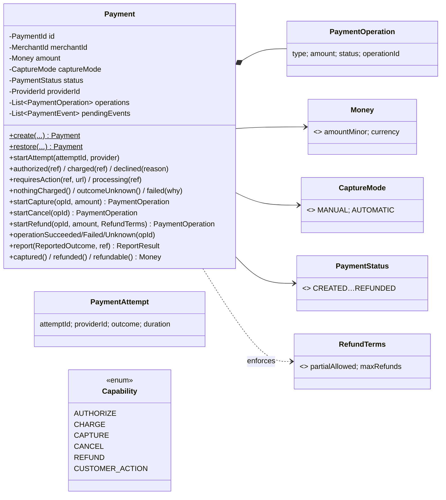

**Change:** `Capability` has no `type()` anymore. It is now a plain business word: "what the
merchant needs a provider to be able to do".

### 5.2 Persistence layer (`persistence/`)

Each repository is an interface **plus** its JDBC implementation, both in this layer. The service
layer depends on the interface, so tests can still swap in an in-memory version. The interface is
still **owned by persistence**, though: its method names, exceptions and return types are
persistence's decision.

```mermaid
classDiagram
    direction TB
    class PaymentRepository {
        <<interface>>
        +save(Payment) Payment
        +find(PaymentId) Optional~Payment~
        +findByStatus(PaymentStatus) List~Payment~
        +findWithUnknownOperations() List~Payment~
    }
    class PaymentAttemptRepository {
        <<interface>>
        +save(PaymentAttempt)
        +forPayment(PaymentId) List~PaymentAttempt~
        +find(attemptId) Optional~PaymentAttempt~
    }
    class ProviderEventInboxRepository {
        <<interface>>
        +receive(ProviderId, eventId, raw) boolean
        +markHandled(ProviderId, eventId, outcome)
    }
    class IdempotencyKeyRepository {
        <<interface>>
        +claim(key, fingerprint) IdempotencyClaim
        +complete(key, status, body)
        +release(key)
    }
    class AuditEventRepository {
        <<interface>>
        +forPayment(PaymentId) List~AuditEventRow~
    }
    class MerchantConfigRepository {
        <<interface>>
        +exists(MerchantId) boolean
        +credentials(MerchantId, ProviderId) Optional~Map~
    }

    class JdbcPaymentRepository
    class JdbcPaymentAttemptRepository
    class JdbcProviderEventInboxRepository
    class JdbcIdempotencyKeyRepository
    class JdbcAuditEventRepository
    class PropertiesMerchantConfigRepository
    class ConcurrentUpdateException

    JdbcPaymentRepository ..|> PaymentRepository
    JdbcPaymentAttemptRepository ..|> PaymentAttemptRepository
    JdbcProviderEventInboxRepository ..|> ProviderEventInboxRepository
    JdbcIdempotencyKeyRepository ..|> IdempotencyKeyRepository
    JdbcAuditEventRepository ..|> AuditEventRepository
    PropertiesMerchantConfigRepository ..|> MerchantConfigRepository
    JdbcPaymentRepository ..> ConcurrentUpdateException : throws
```

Notes:

- `JdbcPaymentRepository` keeps its own `TransactionTemplate`: payment + operations + events are
  written in **one short transaction**, and **no transaction spans a provider call**. This rule must
  be kept on purpose in a layered design (see [§10.3](#103-risks-that-are-specific-to-layered)).
- `AuditTrail`'s SQL moves here as `JdbcAuditEventRepository`. The read-only "audit module" becomes
  `service/audit/AuditService` + this repository.
- `ConfiguredMerchants` splits in two: the raw config map is a repository
  (`PropertiesMerchantConfigRepository`), and the business question ("may this merchant use this
  provider?") becomes `MerchantService`. In production, a `VaultMerchantConfigRepository` would
  replace the properties one.

### 5.3 Integration layer (`integration/`)

This is the heart of Level 8, and the part that changes owner. Today the core defines the provider
SPI and `providers/` implements it. In the layered design, **`integration` owns the SPI, the
gateway, resilience and every adapter**, and exposes one service-facing class: `ProviderGateway`.

#### 5.3.1 The SPI and the gateway

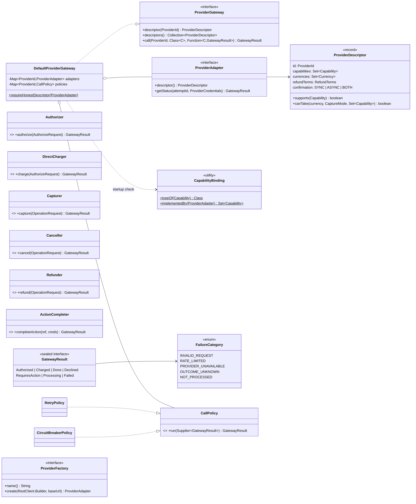

`CapabilityBinding` replaces `Capability.type()`:

```java
package com.designpatterns.level08.integration.gateway;

/** Links the business word (model.Capability) to the interface that provides it. */
public final class CapabilityBinding {
    private static final Map<Capability, Class<?>> TYPES = Map.of(
            Capability.AUTHORIZE, Authorizer.class,
            Capability.CHARGE, DirectCharger.class,
            Capability.CAPTURE, Capturer.class,
            Capability.CANCEL, Canceller.class,
            Capability.REFUND, Refunder.class,
            Capability.CUSTOMER_ACTION, ActionCompleter.class);

    static {   // a new enum value without a binding stops the app, like a lying descriptor does
        if (!TYPES.keySet().equals(EnumSet.allOf(Capability.class))) {
            throw new IllegalStateException("Every Capability needs an interface");
        }
    }

    public static Class<?> typeOf(Capability capability) { return TYPES.get(capability); }
}
```

`DefaultProviderGateway.requireHonestDescriptor` keeps the same check, now through the binding:

```java
List<Capability> lies = Arrays.stream(Capability.values())
        .filter(c -> descriptor.supports(c) != CapabilityBinding.typeOf(c).isInstance(adapter))
        .toList();
```

#### 5.3.2 Provider adapters

Each provider keeps its own sub-package and keeps everything but the gateway, the factory and the
event translator package-private.

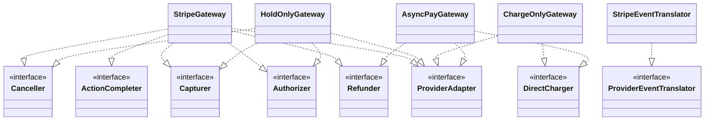

The capability matrix is unchanged:

| Provider | Authorize | Charge | Capture | Cancel | Refund | Customer step | Currencies | Results | Webhooks |
|----------|:-:|:-:|:-:|:-:|:-:|:-:|---|---|:-:|
| stripe | ✅ | | ✅ | ✅ | ✅ | ✅ | EUR USD GBP JPY | sync or async | ✅ |
| paypal | ✅ | | ✅ | ✅ | ✅ | ✅ | EUR USD GBP | sync | ✅ |
| adyen | ✅ | | ✅ | ✅ | ✅ | ✅ | EUR USD GBP JPY | sync or async | ✅ |
| providerx | | ✅ | | | ✅ | | EUR USD | sync | |
| holdonly | ✅ | | ✅ | ✅ | | | EUR USD | sync | |
| chargeonly | | ✅ | | | | | EUR USD | sync | |
| asyncpay | | ✅ | | | once, in full | | EUR SEK | async | |

#### 5.3.3 Webhooks: from controllers to translators

Today each provider folder has a `@RestController`. In layered, only `presentation` has
controllers, so the provider-specific part becomes a translator:

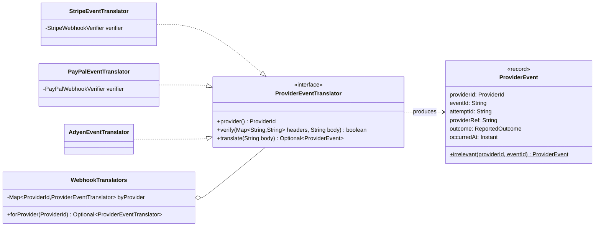

```java
// integration/provider/stripe/StripeEventTranslator.java
@Component
public final class StripeEventTranslator implements ProviderEventTranslator {
    private final StripeWebhookVerifier verifier;

    StripeEventTranslator(@Value("${payment.stripe.webhook-secret}") String secret, Clock clock) {
        this.verifier = new StripeWebhookVerifier(secret, clock);
    }

    @Override public ProviderId provider() { return ProviderId.of("stripe"); }

    @Override public boolean verify(Map<String, String> headers, String body) {
        return verifier.verify(headers.get("sim-signature"), body);
    }

    @Override public Optional<ProviderEvent> translate(String body) {
        return StripeWebhookMapper.toEvent(body);
    }
}
```

### 5.4 Service layer (`service/`)

The use cases keep their logic. What changes: the classes become Spring `@Service`s (or stay plain
classes wired in `ServiceConfig`, see [§10.3](#103-risks-that-are-specific-to-layered)), and they
import repositories and the gateway from the layers below instead of ports from their own package.

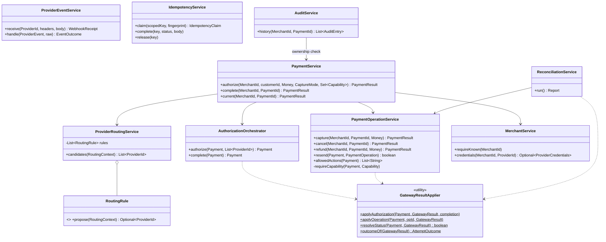

And their dependencies **down** the stack:

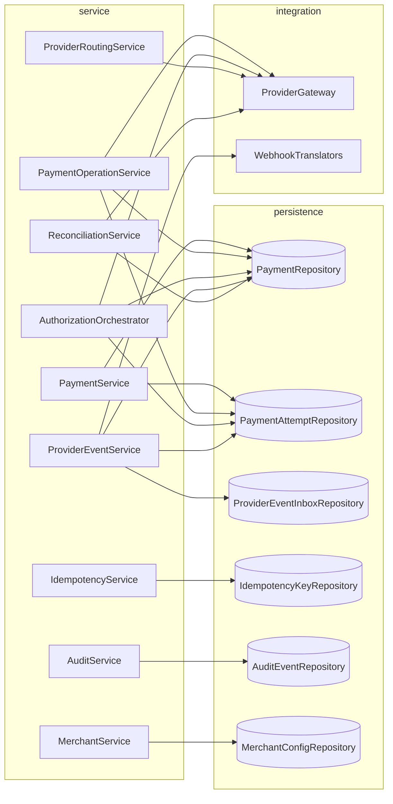

Notes on individual classes:

- **`ProviderRoutingService`** is today's `ProviderRouter`. It stays pure, but now reads
  descriptors from `ProviderGateway.descriptors()` (integration) instead of a port.
- **`GatewayResultApplier`** is new. Today three classes (`PaymentOrchestrator`,
  `PaymentOperations`, `ReconcileUnknownPayments`) each `switch` over `GatewayResult`. In the layered
  design `GatewayResult` is an integration type, so collecting those switches in one service class
  keeps "how a provider answer changes a payment" in one place, and gives one place to update if
  integration adds a result type.
- **`MerchantService`** turns the raw credential map from `MerchantConfigRepository` into
  `ProviderCredentials` (an integration type). This is the only service that builds an integration
  type from persistence data.
- **`ProviderEventService.receive`** is new: it does what each webhook controller did
  (look up translator → verify → translate → `handle`). `handle` is today's
  `RecordProviderPaymentEventHandler.handle`.

#### Key service code sketch

```java
// service/payment/PaymentOperationService.java
@Service
public class PaymentOperationService {
    private final PaymentRepository payments;          // persistence
    private final PaymentAttemptRepository attempts;   // persistence
    private final ProviderGateway gateway;             // integration
    private final MerchantService merchants;           // service

    public PaymentResult refund(MerchantId merchantId, PaymentId paymentId, Money amount) {
        Payment payment = load(merchantId, paymentId);
        ProviderDescriptor descriptor = gateway.descriptor(payment.providerId());
        if (!descriptor.supports(Capability.REFUND)) {             // ③ refused in our words
            throw new OperationNotSupportedException(payment.providerId(), Capability.REFUND);
        }
        PaymentOperation op = payment.startRefund(newOperationId(), amount, descriptor.refundTerms());
        return run(payment, op, payment.refundTarget());
    }

    // NOT @Transactional: the provider call must never sit inside a DB transaction.
    private PaymentResult run(Payment payment, PaymentOperation op, String target) {
        payments.save(payment);                                     // write-ahead, own short tx
        GatewayResult result = send(payment, op, request(payment, op, target));
        Payment stored = record(payment, op.operationId(), result); // reload-apply-save loop
        return new PaymentResult(stored, attempts.forPayment(payment.id()), op.operationId());
    }

    private GatewayResult send(Payment p, PaymentOperation op, OperationRequest r) {
        return switch (op.type()) {
            case CAPTURE -> gateway.call(p.providerId(), Capturer.class, g -> g.capture(r));
            case CANCEL  -> gateway.call(p.providerId(), Canceller.class, g -> g.cancel(r));
            case REFUND  -> gateway.call(p.providerId(), Refunder.class, g -> g.refund(r));
        };
    }
}
```

### 5.5 Presentation layer (`presentation/`)

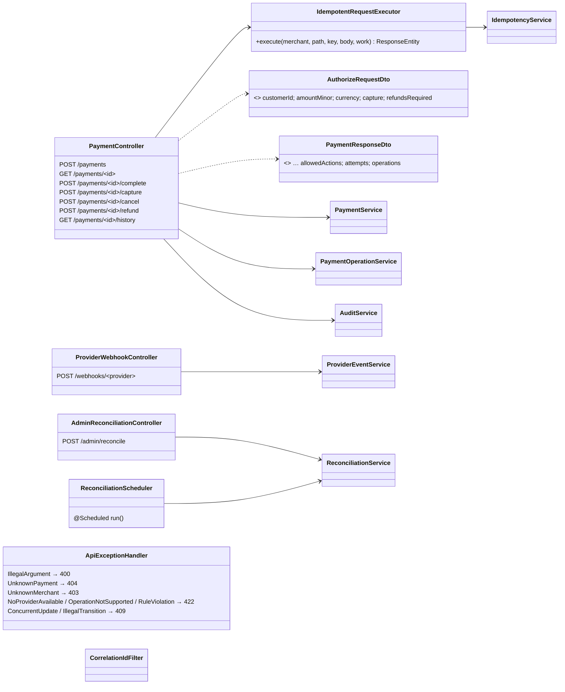

```java
// presentation/webhook/ProviderWebhookController.java
@RestController
class ProviderWebhookController {
    private final ProviderEventService events;

    @PostMapping("/webhooks/{provider}")
    ResponseEntity<Void> receive(@PathVariable String provider,
                                 @RequestHeader Map<String, String> headers,
                                 @RequestBody String body) {
        return switch (events.receive(ProviderId.of(provider), headers, body)) {
            case UNKNOWN_PROVIDER -> ResponseEntity.notFound().build();
            case BAD_SIGNATURE    -> ResponseEntity.status(401).build(); // nothing stored
            case UNREADABLE       -> ResponseEntity.badRequest().build();
            case ACCEPTED         -> ResponseEntity.ok().build();        // also duplicates
        };
    }
}
```

> **Public API change:** Adyen's endpoint is `/webhooks/adyen` today, PayPal's `/webhooks/paypal`,
> Stripe's `/webhooks/stripe`. With `/webhooks/{provider}` the URLs stay the same. Only the routing
> inside the app changes.

### 5.6 Config (`config/`)

`PlatformConfig` is split per layer, so each `@Configuration` class only wires its own layer:

| Class | Builds |
|-------|--------|
| `PersistenceConfig` | `Jdbc*Repository` beans, `PropertiesMerchantConfigRepository`, `Clock` |
| `IntegrationConfig` | `DefaultProviderGateway` from `List<ProviderFactory>` + `payment.enabled`, one `breaker(retry(call))` per provider; `WebhookTranslators` from `List<ProviderEventTranslator>` |
| `ServiceConfig` | Only if services stay framework-free (option B in §10.3). Otherwise not needed: `@Service` + component scan. |
| `RoutingConfig` | Rule list in precedence order, fail-fast on unknown provider ids (unchanged) |

It still names no provider: factories and translators are found by Spring.

---

## 6. Flows in the layered design

### 6.1 Authorize (`POST /payments`)

Same steps as today. Lifelines are now grouped by layer.

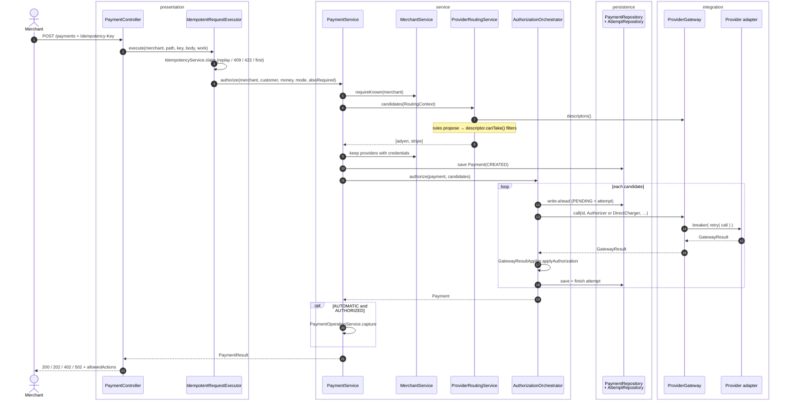

### 6.2 Refund at a provider that can't refund

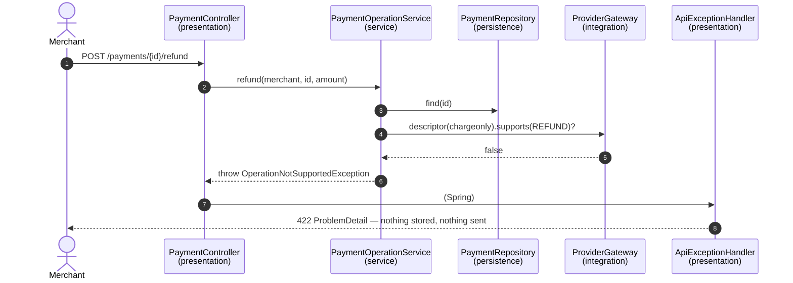

### 6.3 Webhook

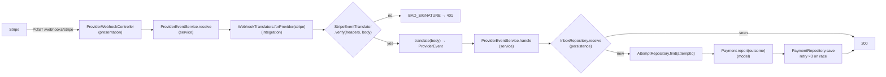

### 6.4 Reconciliation

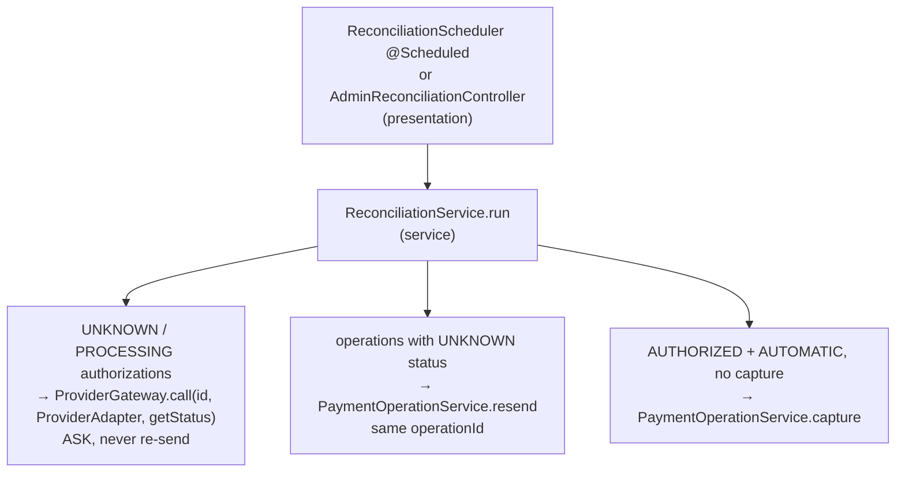

---

## 7. How the Level 8 requirements survive the move

| Level 8 acceptance criterion | Hexagonal (today) | Layered (proposed) | Kept? |
|---|---|---|:-:|
| Capability model (option D: interfaces + descriptor) | `payments/application/capabilities` | `integration/gateway` + `model.Capability` | ✅ |
| Router filters by capability + currency **before** choosing | `ProviderRouter` + `descriptor.canTake` | `ProviderRoutingService` + same `canTake` | ✅ |
| Unsupported op → clear domain-level result, never deep in an adapter | `PaymentOperations.requireCapability` → 422 | `PaymentOperationService.requireCapability` → 422 | ✅ |
| Shared contract test kit, groups from descriptor | `GatewayContractTest` | same class, new imports | ✅ |
| Adding a provider touches only its own folder + registration | `providers/<name>/` + yml | `integration/provider/<name>/` + yml | ✅ (see below) |
| Descriptor can't lie | `InMemoryGatewayRegistry.requireHonestDescriptor` | `DefaultProviderGateway` + `CapabilityBinding` | ✅ |
| `allowedActions` in responses | `PaymentOperations.allowedActions` | `PaymentOperationService.allowedActions` | ✅ |

### 7.1 Onboarding provider #21 in the layered design

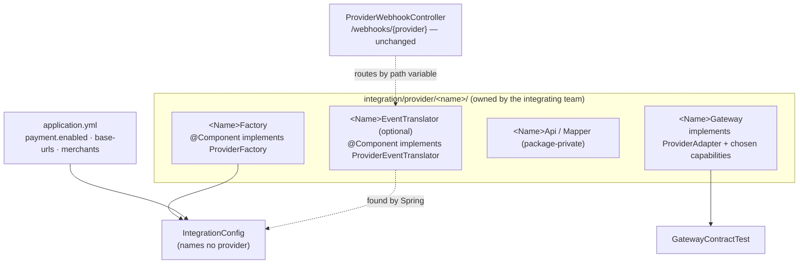

1. Create `integration/provider/<name>/`.
2. Write `<Name>Gateway`: `ProviderAdapter` + only the capability interfaces it really has.
3. Declare its `ProviderDescriptor`.
4. Add `<Name>Factory` (`@Component`, `ProviderFactory`).
5. Add one test class extending `GatewayContractTest`.
6. Webhooks, if any: `<Name>EventTranslator` in the **same folder** (no controller to write).
7. `application.yml`: `payment.enabled`, `base-urls`, credentials, optional routing.

Still **zero lines** changed in `service/`, `presentation/`, `persistence/` or `config/`. Step 6 is
actually smaller than today: the team writes a translator, not a controller.

---

## 8. Enforcing the layers (ArchUnit)

The 10 rules in today's `ArchitectureTest` become one layered rule plus a few targeted ones:

```java
@AnalyzeClasses(packages = "com.designpatterns.level08", importOptions = ImportOption.DoNotIncludeTests.class)
class LayeredArchitectureTest {

    private static final String ROOT = "com.designpatterns.level08";

    @ArchTest
    static final ArchRule layers = layeredArchitecture().consideringOnlyDependenciesInLayers()
            .layer("Presentation").definedBy(ROOT + ".presentation..")
            .layer("Service").definedBy(ROOT + ".service..")
            .layer("Persistence").definedBy(ROOT + ".persistence..")
            .layer("Integration").definedBy(ROOT + ".integration..")
            .layer("Model").definedBy(ROOT + ".model..")
            .layer("Config").definedBy(ROOT + ".config..")

            .whereLayer("Presentation").mayOnlyBeAccessedByLayers("Config")
            .whereLayer("Service").mayOnlyBeAccessedByLayers("Presentation", "Config")
            .whereLayer("Persistence").mayOnlyBeAccessedByLayers("Service", "Config")
            .whereLayer("Integration").mayOnlyBeAccessedByLayers("Service", "Config")
            .whereLayer("Model").mayOnlyBeAccessedByLayers("Presentation", "Service",
                    "Persistence", "Integration", "Config");

    @ArchTest
    static final ArchRule modelIsPureJava = classes()
            .that().resideInAPackage(ROOT + ".model..")
            .should().onlyDependOnClassesThat().resideInAnyPackage(ROOT + ".model..", "java..");

    @ArchTest
    static final ArchRule persistenceAndIntegrationDontMeet = noClasses()
            .that().resideInAPackage(ROOT + ".persistence..")
            .should().dependOnClassesThat().resideInAPackage(ROOT + ".integration..");

    @ArchTest
    static final ArchRule servicesKnowNoWeb = noClasses()
            .that().resideInAPackage(ROOT + ".service..")
            .should().dependOnClassesThat().resideInAnyPackage(
                    "org.springframework.web..", "org.springframework.jdbc..", "com.fasterxml..", "java.net.http..");

    @ArchTest
    static final ArchRule servicesSeeNoConcreteProvider = noClasses()
            .that().resideInAPackage(ROOT + ".service..")
            .should().dependOnClassesThat().resideInAPackage(ROOT + ".integration.provider..");

    @ArchTest
    static final ArchRule providersDontKnowEachOther = slices()
            .matching(ROOT + ".integration.provider.(*)..").should().notDependOnEachOther();

    @ArchTest
    static final ArchRule onlyGatewayFactoryAndTranslatorArePublic = classes()
            .that().resideInAPackage(ROOT + ".integration.provider.*..")
            .and().arePublic()
            .should().implement(ProviderAdapter.class)
            .orShould().implement(ProviderEventTranslator.class);

    @ArchTest
    static final ArchRule noTransactionAroundProviderCalls = noMethods()
            .that().areDeclaredInClassesThat().resideInAPackage(ROOT + ".service..")
            .should().beAnnotatedWith("org.springframework.transaction.annotation.Transactional");
}
```

Two of today's rules can't be kept as they are:

| Today's rule | What happens to it |
|---|---|
| `theCoreDependsOnNoOtherModule` | **Gone by design.** The service layer *must* depend on persistence and integration. It is replaced by the weaker `servicesSeeNoConcreteProvider` and `servicesKnowNoWeb`. |
| `theCoreIsFrameworkFree` | **Weaker.** It survives only if we choose option B in §10.3 (no `@Service`). With `@Service`, the service layer imports Spring stereotypes. |

---

## 9. Testing strategy

| Test kind | Today | Layered | Change |
|---|---|---|---|
| Domain unit tests (`PaymentTest`, `MoneyTest`) | pure | pure (`model`) | none |
| Use case tests (`AuthorizePaymentTest`, `PaymentOperationsTest`, …) | hand-written in-memory ports + `ScriptedGateway` (`PlatformFixture`) | the same fakes implement persistence interfaces and `ProviderGateway` | imports only |
| Router tests | pure | pure | none |
| Gateway TCK (`GatewayContractTest` × 7) | against simulators | same | imports only |
| Webhook tests | controller-level, per provider | translator unit tests (verify + translate) + one `ProviderWebhookController` slice test | **easier**: translators are plain classes |
| Persistence tests (`JdbcPersistenceTest`) | real H2 | same | none |
| e2e (`PlatformApiTest`, `CapabilityApiTest`, …) | full app + simulators | same | none |
| Architecture | `ArchitectureTest`, 10 rules | `LayeredArchitectureTest` (§8) | rewrite |

The fakes in `test/.../support/` (`InMemoryPaymentRepository`, `ScriptedGateway`, …) keep working
because every lower-layer component still has an interface. That only stays true as long as the
team keeps writing interfaces in persistence and integration. Layered teams often drop them and use
Mockito on concrete classes, which makes service tests more brittle.

---

## 10. Trade-offs: layered vs hexagonal

### 10.1 Side-by-side

| Dimension | Hexagonal (today) | Layered (proposed) | Better |
|---|---|---|:-:|
| **Dependency direction** | All inward. JDBC and providers depend on the core | Downward. The core depends on JDBC and integration | Hex |
| **Who owns the provider contract** (`Refunder`, `GatewayResult`, `ProviderDescriptor`) | The business core. Providers conform to it | The integration layer. Business code consumes it | Hex |
| **Risk of provider concepts leaking into business logic** | Low: a provider can only return what the core defined | Medium: integration can grow its API (a new `GatewayResult` field, a provider-flavoured enum) and services see it at once | Hex |
| **Framework-free business logic** | Enforced (`theCoreIsFrameworkFree`) | Optional, and usually lost (`@Service`, `@Transactional`) | Hex |
| **First-read understandability** | Needs the vocabulary: ports, adapters, inbound/outbound | Everyone knows controller → service → repository | Layered |
| **Finding things** | By role (port? adapter?) and by module | By technical layer | Layered (for small teams) |
| **Webhook design** | One controller per provider, inside the provider folder: everything Stripe in one place | One generic controller + translators: less duplication, but "Stripe" spans presentation and integration conceptually | Tie |
| **Provider #21 footprint** | Own folder + yml, 0 core lines | Own folder + yml, 0 core lines; no controller to write | Tie / slightly Layered |
| **Swapping persistence** (H2 → Postgres → event store) | Write a new adapter for an unchanged port | Possible if interfaces are kept, but the interface shape was set by persistence, so a very different store may force a change in services | Hex |
| **Testability of use cases** | In-memory port fakes; no mocking framework needed | Same, **if** interfaces are kept; tends to drift to Mockito on concretes | Hex (more robust) |
| **Number of types** | 113 | ≈ 118 (+ `CapabilityBinding`, `GatewayResultApplier`, `ProviderEventTranslator`, `WebhookTranslators`, `IdempotencyService`, `MerchantService`, split repos; − 3 webhook controllers, `ReconciliationEntryPoints`) | Tie |
| **Indirection for a simple read** (`GET /payments/{id}`) | controller → use case → port → adapter | controller → service → repository | Tie |
| **Change amplification** (add a field shown in the API) | domain → adapter mapping → response DTO | model → repository mapping → service → DTO | Tie |
| **Rule enforcement** | 10 custom ArchUnit rules | one `layeredArchitecture()` + a few targeted rules; easier to read | Layered |
| **Feature cohesion** ("everything about refunds") | Mostly in `payments/` (`commands`, `capabilities`, `domain`) | Spread over `presentation`, `service`, `integration`, `model` | Hex |
| **Team ownership at scale** (20 providers, 2–3 teams) | Platform team owns `payments/`; provider teams own `providers/<name>/` | Platform team owns `service/`, `model/` **and** the SPI in `integration/gateway`; provider teams own `integration/provider/<name>/`. The SPI shares a layer with code it must stay above | Hex |
| **Path to splitting into services** (README "where to go after this") | Ports are already seams | Layers cut horizontally, so services must be cut across layers | Hex |
| **Hiring / onboarding developers who know Spring** | Short learning curve | None | Layered |

### 10.2 The core difference in one picture

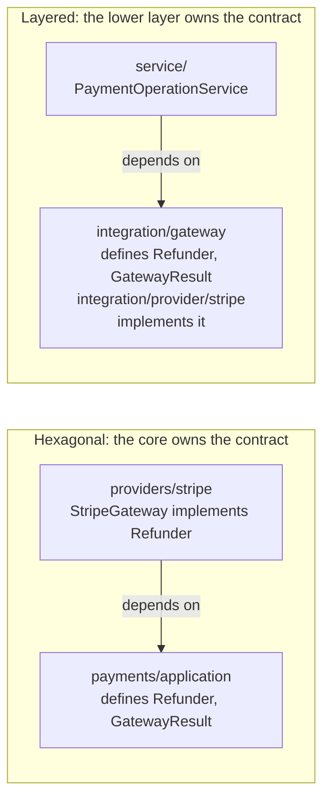

In both pictures `StripeGateway` implements `Refunder`. The difference is **who decides what
`Refunder` looks like**. In hexagonal, the business decides and adapters follow. In layered, the
integration layer decides and the business follows. With 7 providers this hardly shows. With 20
providers and separate teams, the layer that owns the contract is the one that can change the rules
for everyone.

### 10.3 Risks that are specific to layered

| Risk | Why it is likely | Mitigation in this proposal |
|---|---|---|
| **`@Transactional` around a provider call.** A layered service with `@Transactional` on `refund()` holds a DB connection and row lock during an HTTP call that can take seconds, and a rollback after a successful charge loses the record of money that moved. This breaks Level 5's write-ahead design. | It is the default Spring habit in a service layer. | Transactions stay inside repositories. ArchUnit rule `noTransactionAroundProviderCalls` (§8). Comment on `run()` in each service. |
| **Services call `integration.provider.stripe` directly** "just for this one Stripe-only feature". | Nothing in a plain layered rule stops it: it is a legal downward call. | `servicesSeeNoConcreteProvider` rule. |
| **Persistence and integration start calling each other** (e.g. a gateway caching tokens in the DB through a repository). | Both are "infrastructure" and sit side by side. | `persistenceAndIntegrationDontMeet` rule. A token store, if needed, goes through a service. |
| **Interfaces dropped "because there is only one implementation".** | Common in layered codebases. | Keep the rule: every persistence and integration component the service uses is an interface. Tests depend on it (§9). |
| **Spring in services.** `@Service` is convenient. | Spring component scanning. | **Option A:** accept `@Service` and drop "framework-free core". **Option B:** keep services as plain classes, wire them in `ServiceConfig` (like today's `PlatformConfig`). Option B costs ≈ 60 lines of wiring and keeps the services portable. This proposal recommends **B**. |
| **`GatewayResult` drifts towards providers.** Integration adds e.g. `Failed.providerErrorCode` for a dashboard, and services start branching on it. | The type now belongs to integration. | `GatewayResultApplier` is the only service class allowed to `switch` on `GatewayResult` (ArchUnit or code review). |

### 10.4 Where layered is genuinely better

- **Readability for newcomers.** "Controller → service → repository" needs no explanation. Ports,
  driven/driving adapters and composition roots do.
- **One webhook endpoint.** Verification and mapping become plain translator classes; the HTTP part
  is written once.
- **Simpler architecture tests.** `layeredArchitecture()` is a single readable rule.
- **Fewer conceptual homes.** Today a reader must learn that `GatewayResult` lives in
  `application/ports`, while `ProviderAdapter` lives in `application/capabilities`, while
  `InMemoryGatewayRegistry` lives in `providers/`. In layered, everything about calling providers
  lives in `integration/`.

---

## 11. Recommendation

**Keep the hexagonal architecture for Level 8.** Use this proposal as a teaching comparison, and
optionally borrow two of its ideas.

Why:

1. **The level's lesson is about owning the abstraction.** Level 8 asks whether the original
   abstraction survives 20 providers. The answer it gives (segregated interfaces + descriptor) works
   because the **business core** defines what a provider may promise. In layered, that definition
   moves into the integration layer, which is exactly the layer providers live in.
2. **The dangerous mistakes in a payments system are easier to make in layered.** A
   `@Transactional` around a provider call, or a service reaching into one provider, are both legal
   downward calls in a layered design. In hexagonal they are blocked by the structure.
3. **The next steps in the README** (subscriptions, disputes, splitting into services, event
   sourcing) all need seams owned by the core. Ports already give us those.

What is worth borrowing from this proposal, while staying hexagonal:

| Idea | Benefit | Cost |
|---|---|---|
| **Generic `/webhooks/{provider}` controller + `ProviderEventTranslator` per provider** | Less duplicated HTTP code; translators are easy to unit test. Translators still live in `providers/<name>/` and produce the core's `RecordProviderPaymentEvent`, so the hexagon stays intact. | Small: 3 controllers → 1 controller + 3 translators |
| **`GatewayResultApplier`** (one place for the `GatewayResult → Payment` switches) | Today three classes switch over `GatewayResult`; a new result type means three edits | Small |

**When layered would be the right call:** a team mostly made of developers new to these ideas, a
small fixed set of providers owned by one team, and no plan to split the system. In that situation
the readability gain is real and the ownership problem does not appear.

---

## 12. Migration plan (if we go ahead)

Each step keeps the build green. The e2e suite and the TCK are the safety net; they need only
import changes.

| Step | Work | Proves |
|---|---|---|
| 1 | Create the five layer packages. Add `LayeredArchitectureTest` with `@Disabled`. | Nothing yet |
| 2 | Move `payments/domain/*` → `model/`. Move `Capability` to `model/`, drop `type()`, add `integration/gateway/CapabilityBinding`. | Domain + TCK green |
| 3 | Move `platform/persistence/*` → `persistence/jdbc/`; move port interfaces next to them, renamed `*Repository`. Move `AuditTrail` SQL → `JdbcAuditEventRepository`; split `ConfiguredMerchants`. | `JdbcPersistenceTest` green |
| 4 | Move capability interfaces, `GatewayRegistry`, `GatewayResult`, `FailureCategory`, request records, `ProviderCredentials`, `CallPolicy` → `integration/gateway`; `platform/resilience` → `integration/resilience`; `providers/*` → `integration/provider/*`. Rename registry → `DefaultProviderGateway`. | TCK × 7 green |
| 5 | Introduce `ProviderEventTranslator` per webhook provider; add `ProviderEventService.receive`; replace 3 controllers with `ProviderWebhookController`. | Webhook tests green |
| 6 | Move use cases → `service/*` with new names; extract `GatewayResultApplier`; add `MerchantService`, `IdempotencyService`, `AuditService`. Wire in `ServiceConfig` (option B). | Use case tests green |
| 7 | Move `api/*` → `presentation/*`; `ReconciliationEntryPoints` → `AdminReconciliationController` + `ReconciliationScheduler`. | e2e green |
| 8 | Split `PlatformConfig` into `PersistenceConfig`, `IntegrationConfig`, `ServiceConfig`. Delete old `ArchitectureTest`, enable `LayeredArchitectureTest`. | All green, rules enforced |
| 9 | Update `../../08-hexagonal-architecture/docs/ARCHITECTURE.md`, `ADDING-A-PROVIDER.md`; add **ADR-0006: layered architecture** with this comparison. | Docs match code |

Estimated size: ~110 file moves, ~10 new classes, ~4 removed classes, behaviour unchanged.

---

## Appendix A: every class, old location → new location

Paths are relative to `com.designpatterns.level08`. **Bold** = renamed or redesigned.

### Entry points

| Today | Layered |
|---|---|
| `PaymentPlatformApplication` | `PaymentPlatformApplication` |
| `api.PaymentController` | `presentation.rest.PaymentController` |
| `api.IdempotentRequests` | `presentation.rest.`**`IdempotentRequestExecutor`** (uses `IdempotencyService`) |
| `api.ApiExceptionHandler` | `presentation.rest.ApiExceptionHandler` |
| `api.CorrelationIdFilter` | `presentation.rest.CorrelationIdFilter` |
| `api.PaymentRequests` (`Authorize`, `Amount`) | `presentation.rest.dto.`**`AuthorizeRequestDto`**, **`AmountDto`** |
| `api.PaymentResponse` | `presentation.rest.dto.`**`PaymentResponseDto`** |
| `api.ReconciliationEntryPoints.Admin` | `presentation.rest.`**`AdminReconciliationController`** |
| `api.ReconciliationEntryPoints.Job` | `presentation.scheduling.`**`ReconciliationScheduler`** |
| `providers.stripe.webhook.StripeWebhookController` | **removed** → `presentation.webhook.ProviderWebhookController` + `integration.provider.stripe.StripeEventTranslator` |
| `providers.paypal.webhook.PayPalWebhookController` | **removed** → same + `PayPalEventTranslator` |
| `providers.adyen.webhook.AdyenNotificationController` | **removed** → same + `AdyenEventTranslator` |

### Use cases

| Today | Layered |
|---|---|
| `payments.application.commands.AuthorizePayment` | `service.payment.`**`PaymentService`** |
| `payments.application.commands.PaymentOperations` | `service.payment.`**`PaymentOperationService`** |
| `payments.application.commands.PaymentResult` | `service.payment.PaymentResult` |
| `payments.application.commands.*Exception` (4) | `service.exception.*` |
| `payments.application.orchestration.PaymentOrchestrator` | `service.payment.`**`AuthorizationOrchestrator`** |
| (switches in 3 classes) | `service.payment.`**`GatewayResultApplier`** (new) |
| `payments.application.routing.ProviderRouter` | `service.routing.`**`ProviderRoutingService`** |
| `payments.application.routing.RoutingContext`, `RoutingRule` | `service.routing.*` |
| `payments.application.routing.rules.*` (3) | `service.routing.rules.*` |
| `payments.application.events.RecordProviderPaymentEventHandler` | `service.event.`**`ProviderEventService`** |
| `payments.application.events.EventOutcome` | `service.event.EventOutcome` |
| `payments.application.events.RecordProviderPaymentEvent` | `integration.webhook.`**`ProviderEvent`** |
| `payments.application.reconciliation.ReconcileUnknownPayments` | `service.reconciliation.`**`ReconciliationService`** |
| `merchants.ConfiguredMerchants` | **split** → `service.merchant.MerchantService` + `persistence.config.PropertiesMerchantConfigRepository` |
| `audit.AuditTrail` | **split** → `service.audit.AuditService` + `persistence.jdbc.JdbcAuditEventRepository` |
| `audit.AuditEntry` | `service.audit.AuditEntry` |
| — | `service.idempotency.`**`IdempotencyService`** (new) |

### Ports → owned by the layer that implements them

| Today (`payments.application.ports`) | Layered |
|---|---|
| `PaymentRepository` | `persistence.PaymentRepository` |
| `PaymentAttemptLog` | `persistence.`**`PaymentAttemptRepository`** |
| `ProviderEventInbox` | `persistence.`**`ProviderEventInboxRepository`** |
| `IdempotencyStore` (+ `Claim`) | `persistence.`**`IdempotencyKeyRepository`** + **`IdempotencyClaim`** |
| `MerchantCredentials` | `persistence.`**`MerchantConfigRepository`** (raw) + `service.merchant.MerchantService` (business) |
| `ConcurrentUpdateException` | `persistence.ConcurrentUpdateException` |
| `GatewayRegistry` | `integration.gateway.`**`ProviderGateway`** |
| `GatewayResult`, `FailureCategory` | `integration.gateway.*` |
| `AuthorizeRequest`, `OperationRequest`, `ProviderCredentials` | `integration.gateway.*` |
| `CallPolicy` | `integration.resilience.CallPolicy` |

### Capabilities

| Today (`payments.application.capabilities`) | Layered |
|---|---|
| `ProviderAdapter` | `integration.gateway.ProviderAdapter` |
| `Authorizer`, `DirectCharger`, `Capturer`, `Canceller`, `Refunder`, `ActionCompleter` | `integration.gateway.capability.*` |
| `ProviderDescriptor` | `integration.gateway.ProviderDescriptor` |
| `Capability` | **`model.Capability`** (without `type()`) + `integration.gateway.`**`CapabilityBinding`** |

### Infrastructure

| Today | Layered |
|---|---|
| `platform.persistence.JdbcPaymentRepository` | `persistence.jdbc.JdbcPaymentRepository` |
| `platform.persistence.JdbcPaymentAttemptLog` | `persistence.jdbc.`**`JdbcPaymentAttemptRepository`** |
| `platform.persistence.JdbcProviderEventInbox` | `persistence.jdbc.`**`JdbcProviderEventInboxRepository`** |
| `platform.persistence.JdbcIdempotencyStore` | `persistence.jdbc.`**`JdbcIdempotencyKeyRepository`** |
| `platform.resilience.RetryPolicy`, `CircuitBreakerPolicy` | `integration.resilience.*` |
| `providers.InMemoryGatewayRegistry` | `integration.gateway.`**`DefaultProviderGateway`** |
| `providers.support.ProviderFactory` | `integration.gateway.ProviderFactory` |
| `providers.support.ProviderHttp`, `Signatures`, `SyntheticClient` | `integration.support.*` |
| `providers.<name>.*` (gateways, factories, APIs, mappers) | `integration.provider.<name>.*` |
| `providers.<name>.webhook.*Mapper`, `*Verifier` | `integration.provider.<name>.*` (package-private, used by the translator) |

### Domain

| Today (`payments.domain`) | Layered |
|---|---|
| all 18 classes | `model.*`, unchanged |

### Config

| Today | Layered |
|---|---|
| `config.PaymentProperties` | `config.PaymentProperties` |
| `config.PlatformConfig` | **split** → `config.PersistenceConfig`, `config.IntegrationConfig`, `config.ServiceConfig` |
| `config.RoutingConfig` | `config.RoutingConfig` |

### Tests

| Today | Layered |
|---|---|
| `architecture.ArchitectureTest` | **`architecture.LayeredArchitectureTest`** |
| `providers.GatewayContractTest` + 7 subclasses | `integration.provider.GatewayContractTest` + 7 |
| `providers.*.webhook.*Test` | `integration.provider.*.*EventTranslatorTest` + one `ProviderWebhookControllerTest` |
| `payments.application.*Test` | `service.*Test` |
| `payments.domain.*Test` | `model.*Test` |
| `platform.*Test` | `persistence.jdbc.*Test`, `integration.resilience.*Test` |
| `support.*` fakes | unchanged (now implement persistence / integration interfaces) |
| `e2e.*` | unchanged |

---

## Appendix B: glossary

| Term | Meaning here |
|---|---|
| **Layered (N-tier) architecture** | Code split into horizontal layers; each layer only uses the layers below it. |
| **Closed layer** | A layer that callers above may not skip over. `service` is closed: `presentation` can't reach `persistence` directly. |
| **Relaxed layering** | Some layers (here `model`) may be used by every layer above them. |
| **Hexagonal / ports & adapters** | The business core defines interfaces (ports); infrastructure implements them (adapters). All dependencies point into the core. |
| **Dependency Inversion** | High-level code defines the abstraction; low-level code implements it. The defining feature of hexagonal, absent from plain layered. |
| **SPI** | Service Provider Interface: the contract plug-ins implement. Here, `ProviderAdapter` + capability interfaces. |
| **TCK** | Technology Compatibility Kit: one shared test suite every adapter must pass (`GatewayContractTest`). |
| **Composition root** | The one place that builds and connects all objects (`config/`). |
